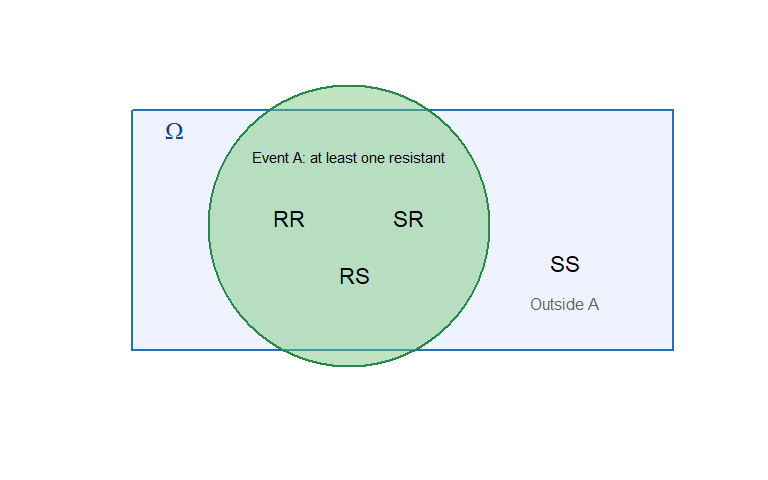
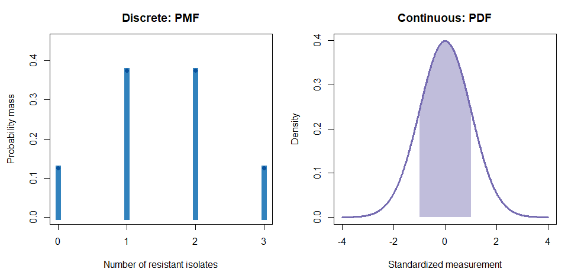
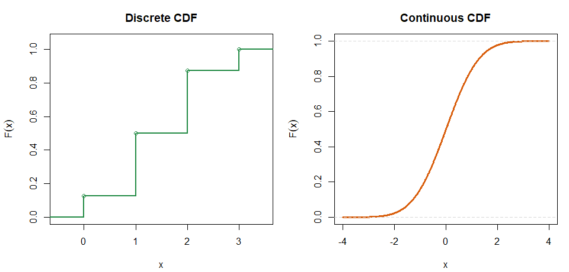
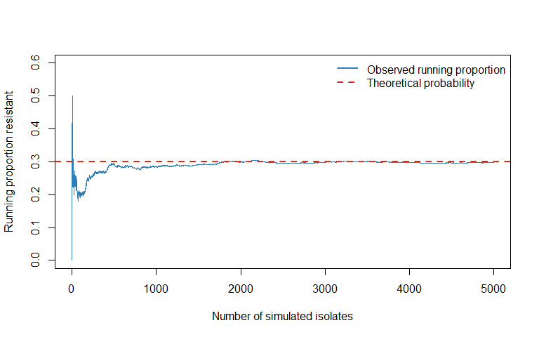

Chapter 12: Probability Foundations for Statistical Inference
================
Sandeep Singh

- [1. Why probability matters in
  biology](#1-why-probability-matters-in-biology)
- [2. The basic language of
  probability](#2-the-basic-language-of-probability)
  - [2.1 Random experiment](#21-random-experiment)
  - [2.2 Outcome and sample space](#22-outcome-and-sample-space)
  - [2.3 Event](#23-event)
- [3. What does a probability mean?](#3-what-does-a-probability-mean)
  - [3.1 Long-run relative frequency](#31-long-run-relative-frequency)
  - [3.2 The model is conditional on
    assumptions](#32-the-model-is-conditional-on-assumptions)
- [4. Core probability rules](#4-core-probability-rules)
  - [4.1 The complement rule](#41-the-complement-rule)
    - [Worked example: a negative test
      result](#worked-example-a-negative-test-result)
  - [4.2 The general addition rule](#42-the-general-addition-rule)
    - [Worked example: two clinical
      characteristics](#worked-example-two-clinical-characteristics)
  - [4.3 Mutually exclusive events](#43-mutually-exclusive-events)
  - [4.4 Conditional probability](#44-conditional-probability)
    - [Worked example: response among treated
      patients](#worked-example-response-among-treated-patients)
  - [4.5 Multiplication rule](#45-multiplication-rule)
  - [4.6 Independence](#46-independence)
    - [Mutually exclusive is not the same as
      independent](#mutually-exclusive-is-not-the-same-as-independent)
- [5. Bayes’ theorem: reversing a conditional
  probability](#5-bayes-theorem-reversing-a-conditional-probability)
  - [5.1 Worked diagnostic example using 10,000
    people](#51-worked-diagnostic-example-using-10000-people)
- [6. From events to random
  variables](#6-from-events-to-random-variables)
  - [6.1 What is a probability
    distribution?](#61-what-is-a-probability-distribution)
- [7. Two major classes of random
  variables](#7-two-major-classes-of-random-variables)
  - [7.1 Discrete random variables](#71-discrete-random-variables)
  - [7.2 Continuous random variables](#72-continuous-random-variables)
  - [7.3 Recorded values versus the underlying
    variable](#73-recorded-values-versus-the-underlying-variable)
- [8. Discrete probability
  distributions](#8-discrete-probability-distributions)
  - [8.1 Probability mass function](#81-probability-mass-function)
    - [Worked example: number of resistant
      isolates](#worked-example-number-of-resistant-isolates)
  - [8.2 Cumulative distribution function for a discrete
    variable](#82-cumulative-distribution-function-for-a-discrete-variable)
- [9. Continuous probability
  distributions](#9-continuous-probability-distributions)
  - [9.1 Probability density function](#91-probability-density-function)
  - [9.2 Why an exact value has probability
    zero](#92-why-an-exact-value-has-probability-zero)
  - [9.3 Density is not probability](#93-density-is-not-probability)
  - [9.4 Worked example: a uniform measurement
    model](#94-worked-example-a-uniform-measurement-model)
  - [9.5 Cumulative distribution function for a continuous
    variable](#95-cumulative-distribution-function-for-a-continuous-variable)
- [10. Visual comparison: PMF, PDF, and
  CDF](#10-visual-comparison-pmf-pdf-and-cdf)
- [11. Expected value: the long-run
  centre](#11-expected-value-the-long-run-centre)
  - [11.1 Hand calculation for a discrete
    distribution](#111-hand-calculation-for-a-discrete-distribution)
- [12. Variance and standard deviation of a random
  variable](#12-variance-and-standard-deviation-of-a-random-variable)
  - [12.1 Hand calculation](#121-hand-calculation)
- [13. Important distribution families: a
  roadmap](#13-important-distribution-families-a-roadmap)
  - [13.1 Discrete distributions](#131-discrete-distributions)
  - [13.2 Continuous distributions](#132-continuous-distributions)
- [14. Distribution functions in R: the `d`, `p`, `q`, `r`
  pattern](#14-distribution-functions-in-r-the-d-p-q-r-pattern)
  - [14.1 Discrete example using a Binomial
    model](#141-discrete-example-using-a-binomial-model)
  - [14.2 Continuous example using a Normal
    model](#142-continuous-example-using-a-normal-model)
  - [14.3 Translating probability phrases into
    R](#143-translating-probability-phrases-into-r)
- [15. Simulation: probability becomes
  visible](#15-simulation-probability-becomes-visible)
- [16. A practical framework for choosing a
  distribution](#16-a-practical-framework-for-choosing-a-distribution)
- [17. Common mistakes and how to avoid
  them](#17-common-mistakes-and-how-to-avoid-them)
  - [Mistake 1: treating probability as a
    guarantee](#mistake-1-treating-probability-as-a-guarantee)
  - [Mistake 2: confusing mutually exclusive events with independent
    events](#mistake-2-confusing-mutually-exclusive-events-with-independent-events)
  - [Mistake 3: reversing conditional
    probabilities](#mistake-3-reversing-conditional-probabilities)
  - [Mistake 4: treating a density as a
    probability](#mistake-4-treating-a-density-as-a-probability)
  - [Mistake 5: forgetting the discrete endpoint
    correction](#mistake-5-forgetting-the-discrete-endpoint-correction)
  - [Mistake 6: assuming rounding changes a variable’s scientific
    nature](#mistake-6-assuming-rounding-changes-a-variables-scientific-nature)
  - [Mistake 7: selecting a distribution by name
    alone](#mistake-7-selecting-a-distribution-by-name-alone)
- [18. Guided practice](#18-guided-practice)
  - [18.1 Basic questions](#181-basic-questions)
  - [18.2 Intermediate questions](#182-intermediate-questions)
  - [18.3 Advanced questions](#183-advanced-questions)
- [19. Mini-project: antibiotic resistance
  probability](#19-mini-project-antibiotic-resistance-probability)
- [20. Chapter summary](#20-chapter-summary)
- [21. Competency checklist](#21-competency-checklist)
- [22. Glossary](#22-glossary)
- [References](#references)

<script type="text/javascript" async
    src="https://polyfill.io/v3/polyfill.min.js?features=es6">
</script>

<script type="text/javascript" async
    src="https://cdnjs.cloudflare.com/ajax/libs/mathjax/3.2.0/es5/tex-mml-chtml.js">
</script>

# 1. Why probability matters in biology

Biological systems vary. Two genetically similar cells may express
different amounts of a protein. Two patients receiving the same
treatment may have different outcomes. Repeated sequencing of the same
region may produce different numbers of errors.

Probability gives us a language for this uncertainty. It does not tell
us exactly what will happen to one future patient or one future sample.
Instead, it describes the pattern we expect across many comparable
repetitions.

Examples include:

- the probability that a bacterial isolate is antibiotic resistant;
- the probability that a diagnostic test is positive;
- the number of colonies growing on a plate;
- the time until a patient relapses; and
- the concentration of a biomarker in blood.

This chapter builds the bridge from basic probability rules to
**probability distributions**. Detailed distribution families will be
studied in later chapters.

# 2. The basic language of probability

## 2.1 Random experiment

A **random experiment** is a repeatable process whose result is
uncertain before we observe it.

Examples:

- test one bacterial isolate for resistance;
- record whether a patient responds to treatment;
- count the colonies on one culture plate; or
- measure the fasting glucose level of one participant.

The word *experiment* does not always mean a controlled laboratory
experiment. It can mean any process that produces an uncertain
observation.

## 2.2 Outcome and sample space

An **outcome** is one possible result. The **sample space**, written
$\Omega$, is the set of all possible outcomes.

If one isolate is classified as resistant (`R`) or susceptible (`S`),
then:

$$\Omega=\{R,S\}.$$

If two isolates are tested, then:

$$\Omega=\{RR,RS,SR,SS\}.$$

Order matters here: `RS` means that the first isolate is resistant and
the second is susceptible.

## 2.3 Event

An **event** is a collection of one or more outcomes. For two isolates,
define:

$$A=\{\text{at least one resistant isolate}\}.$$

Then:

$$A=\{RR,RS,SR\}.$$

If the four outcomes are equally likely:

$$P(A)=\frac{3}{4}=0.75.$$

``` r
plot(
  NA, xlim = c(0, 10), ylim = c(0, 7),
  xlab = "", ylab = "", axes = FALSE
)
rect(0.5, 0.5, 9.5, 6.5, col = "#EFF3FF", border = "#2171B5", lwd = 2)
text(1.2, 6.0, expression(Omega), cex = 1.5, col = "#084594")
symbols(
  x = 4.1, y = 3.6, circles = 2.35,
  inches = FALSE, add = TRUE,
  bg = adjustcolor("#74C476", alpha.f = 0.45),
  fg = "#238B45", lwd = 2
)
text(4.1, 5.35, "Event A: at least one resistant", cex = 0.95)
text(c(3.1, 4.2, 5.1, 7.7), c(3.8, 2.4, 3.8, 2.7),
     c("RR", "RS", "SR", "SS"), cex = 1.35)
text(7.7, 1.7, "Outside A", col = "#636363")
```

<div class="figure" style="text-align: center">


<p class="caption">

A sample space contains all possible outcomes; an event contains
selected outcomes.
</p>

</div>

# 3. What does a probability mean?

A probability is a number between 0 and 1:

$$0\leq P(A)\leq1.$$

- $P(A)=0$: the event is impossible under the model.
- $P(A)=1$: the event is certain under the model.
- $P(A)=0.30$: the event is expected in about 30% of comparable
  repetitions.

Probability may also be written as a percentage. A probability of 0.30
equals 30%.

## 3.1 Long-run relative frequency

Suppose we repeatedly sample isolates from the same population. If 30%
are resistant, the observed proportion resistant should move toward 0.30
as the sample size grows:

$$\widehat P(A)=\frac{\text{number of times }A\text{ occurs}}
{\text{number of repetitions}}.$$

This is a long-run interpretation. It does **not** mean that exactly 3
of every 10 consecutive isolates must be resistant.

## 3.2 The model is conditional on assumptions

A probability is meaningful only for a specified setting. The
probability of resistance can differ by species, hospital, specimen
type, treatment history, or calendar period. A numerical probability
should therefore be accompanied by a clear description of the population
and conditions.

# 4. Core probability rules

## 4.1 The complement rule

The complement of event $A$, written $A^c$, means that $A$ does not
occur:

$$P(A^c)=1-P(A).$$

### Worked example: a negative test result

If the probability that a screening test is positive is 0.18, then:

$$P(\text{negative})=1-P(\text{positive})=1-0.18=0.82.$$

``` r
p_positive <- 0.18
p_negative <- 1 - p_positive
p_negative
```

    ## [1] 0.82

## 4.2 The general addition rule

For any two events $A$ and $B$:

$$P(A\cup B)=P(A)+P(B)-P(A\cap B).$$

The intersection is subtracted because observations in both events were
counted twice.

### Worked example: two clinical characteristics

Suppose:

$$P(A)=0.40,\quad P(B)=0.35,\quad P(A\cap B)=0.15,$$

where $A$ is hypertension and $B$ is diabetes. Then:

$$P(A\cup B)=0.40+0.35-0.15=0.60.$$

Thus, 60% have hypertension, diabetes, or both.

``` r
p_hypertension <- 0.40
p_diabetes <- 0.35
p_both <- 0.15
p_either <- p_hypertension + p_diabetes - p_both
p_either
```

    ## [1] 0.6

## 4.3 Mutually exclusive events

Events are **mutually exclusive** if they cannot occur together:

$$P(A\cap B)=0.$$

The addition rule then becomes:

$$P(A\cup B)=P(A)+P(B).$$

For one person at one time, the blood groups `A` and `B` are mutually
exclusive categories if the categories are defined as `A`, `B`, `AB`,
and `O`. A person cannot simultaneously belong to the `A` category and
the `B` category.

## 4.4 Conditional probability

Conditional probability asks for the probability of $A$ among
observations for which $B$ is already known:

$$P(A\mid B)=\frac{P(A\cap B)}{P(B)},\qquad P(B)>0.$$

### Worked example: response among treated patients

In a study of 100 patients:

- 60 received treatment;
- 30 both received treatment and responded.

Therefore:

$$P(\text{response}\mid\text{treatment})
=\frac{30/100}{60/100}
=\frac{30}{60}
=0.50.$$

The denominator changes from all 100 patients to the 60 treated
patients.

``` r
n_total <- 100
n_treated <- 60
n_treated_and_response <- 30

p_response_given_treatment <-
  (n_treated_and_response / n_total) / (n_treated / n_total)
p_response_given_treatment
```

    ## [1] 0.5

## 4.5 Multiplication rule

Rearranging the conditional-probability formula gives:

$$P(A\cap B)=P(A\mid B)P(B).$$

Equivalently:

$$P(A\cap B)=P(B\mid A)P(A).$$

If 60% receive treatment and 50% of treated patients respond:

$$P(\text{treatment and response})=0.60\times0.50=0.30.$$

## 4.6 Independence

Events $A$ and $B$ are **independent** if knowing that one occurred does
not change the probability of the other:

$$P(A\mid B)=P(A).$$

An equivalent rule is:

$$P(A\cap B)=P(A)P(B).$$

### Mutually exclusive is not the same as independent

If two events are mutually exclusive and one occurs, we know that the
other did not occur. Therefore, mutually exclusive events with positive
probabilities are **not** independent.

| Relationship | Meaning | Key equation |
|----|----|----|
| Mutually exclusive | Cannot happen together | $P(A\cap B)=0$ |
| Independent | One does not change the probability of the other | $P(A\cap B)=P(A)P(B)$ |

# 5. Bayes’ theorem: reversing a conditional probability

Bayes’ theorem connects $P(A\mid B$ with $P(B\mid A)$:

$$P(A\mid B)=
\frac{P(B\mid A)P(A)}{P(B)}.$$

For a diagnostic test:

$$P(D\mid +)=
\frac{P(+\mid D)P(D)}
{P(+\mid D)P(D)+P(+\mid D^c)P(D^c)}.$$

Here:

- $D$: disease is present;
- $+$: test result is positive;
- $P(D)$: prevalence;
- $P(+\mid D)$: sensitivity; and
- $P(+\mid D^c)$: false-positive probability, equal to
  $1-\text{specificity}$.

## 5.1 Worked diagnostic example using 10,000 people

Assume:

- prevalence = 1%;
- sensitivity = 90%; and
- specificity = 95%.

Among 10,000 people:

1.  Diseased: $10{,}000\times0.01=100$.
2.  True positives: $100\times0.90=90$.
3.  Without disease: $10{,}000-100=9{,}900$.
4.  False positives: $9{,}900\times(1-0.95)=495$.
5.  All positive tests: $90+495=585$.

Therefore:

$$P(D\mid +)=\frac{90}{585}=0.1538.$$

Only about 15.4% of positive results correspond to disease in this
low-prevalence population. This does not mean the test is poor. It shows
that predictive values depend strongly on prevalence.

``` r
population <- 10000
prevalence <- 0.01
sensitivity <- 0.90
specificity <- 0.95

diseased <- population * prevalence
not_diseased <- population - diseased

true_positive <- diseased * sensitivity
false_positive <- not_diseased * (1 - specificity)

positive_predictive_value <-
  true_positive /
  (true_positive + false_positive)

diagnostic_table <- data.frame(
  Group = c(
    "Disease present",
    "Disease absent"
  ),
  Population = c(
    diseased,
    not_diseased
  ),
  Positive_tests = c(
    true_positive,
    false_positive
  )
)

cat(
  knitr::kable(
    diagnostic_table,
    format = "pipe",
    digits = 0,
    row.names = FALSE,
    caption = "Expected diagnostic-test results among 10,000 people."
  ),
  sep = "\n"
)
```

| Group           | Population | Positive_tests |
|:----------------|-----------:|---------------:|
| Disease present |        100 |             90 |
| Disease absent  |       9900 |            495 |

Expected diagnostic-test results among 10,000 people.

``` r
cat("\n\n")
```

``` r
cat(
  "**Positive predictive value:** ",
  sprintf("%.4f", positive_predictive_value),
  " or ",
  sprintf("%.1f%%", 100 * positive_predictive_value),
  "\n",
  sep = ""
)
```

**Positive predictive value:** 0.1538 or 15.4%

# 6. From events to random variables

An event is a set of outcomes. A **random variable** converts outcomes
into numerical values.

Suppose three bacterial isolates are tested. Define:

$$X=\text{number of resistant isolates among the three}.$$

If the outcome is `RSR`, then $X=2$. The random variable is $X$; the
observed numerical value is $x=2$.

We conventionally use:

- an uppercase letter such as $X$ for the random variable; and
- a lowercase letter such as $x$ for one possible value.

## 6.1 What is a probability distribution?

A **probability distribution** describes:

1.  which values a random variable can take; and
2.  how probability is allocated across those values.

The set of possible values is called the **support**.

For the number of resistant isolates among three:

$$\mathcal S_X=\{0,1,2,3\}.$$

# 7. Two major classes of random variables

Random variables are commonly classified as **discrete** or
**continuous**.

| Feature | Discrete random variable | Continuous random variable |
|----|----|----|
| Typical data | Counts or distinct categories | Measurements |
| Possible values | Finite or countably infinite | Any value in an interval |
| Biological example | Number of colonies | Cell diameter |
| Main function | Probability mass function (PMF) | Probability density function (PDF) |
| Probability at one exact value | Can be greater than 0 | Equals 0 under a continuous model |
| How interval probability is found | Add masses | Find area under a density curve |

## 7.1 Discrete random variables

A discrete random variable takes separate, countable values.

Examples:

- number of mutated bases in a sequence;
- number of infected plants in a greenhouse;
- number of sequencing reads mapped to a gene; and
- number of treatment responders.

Values such as 0, 1, 2, and 3 are possible colony counts. A value such
as 2.4 colonies is not possible.

## 7.2 Continuous random variables

A continuous random variable can, in principle, take any value in an
interval.

Examples:

- blood pressure;
- protein concentration;
- cell diameter;
- body mass; and
- time until an event.

An instrument may round a continuous measurement. A cell diameter
recorded as 12.4 micrometres could represent an underlying value between
nearby measurement limits.

## 7.3 Recorded values versus the underlying variable

The data stored in a computer can look discrete even when the underlying
variable is continuous. For example, body mass may be stored to one
decimal place. The scientific measurement process—not merely the number
of decimal places—determines whether a continuous model is reasonable.

# 8. Discrete probability distributions

## 8.1 Probability mass function

The **probability mass function** (PMF) gives the probability of each
possible discrete value:

$$p(x)=P(X=x).$$

A valid PMF must satisfy:

$$p(x)\geq0$$

and

$$\sum_xp(x)=1.$$

### Worked example: number of resistant isolates

Suppose the distribution is:

|      $x$ |     0 |     1 |     2 |     3 |
|---------:|------:|------:|------:|------:|
| $P(X=x)$ | 0.125 | 0.375 | 0.375 | 0.125 |

Then:

$$P(X=2)=0.375.$$

The probability of at most one resistant isolate is:

$$P(X\leq1)=P(X=0)+P(X=1)
=0.125+0.375
=0.500.$$

The probability of at least one is easiest by the complement rule:

$$P(X\geq1)=1-P(X=0)=1-0.125=0.875.$$

``` r
x_discrete <- 0:3
p_discrete <- c(
  0.125,
  0.375,
  0.375,
  0.125
)

discrete_distribution <- data.frame(
  Resistant_isolates = x_discrete,
  Probability = p_discrete,
  Cumulative_probability = cumsum(p_discrete)
)

cat(
  knitr::kable(
    discrete_distribution,
    format = "pipe",
    digits = 3,
    row.names = FALSE,
    caption = paste(
      "Probability distribution for the number",
      "of resistant isolates."
    )
  ),
  sep = "\n"
)
```

| Resistant_isolates | Probability | Cumulative_probability |
|-------------------:|------------:|-----------------------:|
|                  0 |       0.125 |                  0.125 |
|                  1 |       0.375 |                  0.500 |
|                  2 |       0.375 |                  0.875 |
|                  3 |       0.125 |                  1.000 |

Probability distribution for the number of resistant isolates.

``` r
cat("\n\n")
```

## 8.2 Cumulative distribution function for a discrete variable

The **cumulative distribution function** (CDF) is:

$$F(x)=P(X\leq x).$$

For a discrete variable, the CDF rises in steps because probability is
concentrated at separate values.

# 9. Continuous probability distributions

## 9.1 Probability density function

A **probability density function** (PDF), written $f(x)$, describes how
probability is distributed across a continuum.

A valid density satisfies:

$$f(x)\geq0$$

and

$$\int_{-\infty}^{\infty}f(x)\,dx=1.$$

For a continuous variable, probability is the area under the density
curve:

$$P(a\leq X\leq b)=\int_a^b f(x)\,dx.$$

## 9.2 Why an exact value has probability zero

Under a continuous model:

$$P(X=x)=0.$$

This does not mean that observing a recorded value such as 10.0 is
impossible. It means that a single mathematical point has no width and
therefore no area. Real measurements are recorded within an interval
determined by instrument precision and rounding.

## 9.3 Density is not probability

The height of a density curve is not itself a probability. A probability
is an **area**. Density may even exceed 1 when the range is narrow,
provided the total area is 1.

## 9.4 Worked example: a uniform measurement model

Suppose a standardized laboratory delay $X$ is modeled as uniformly
distributed between 0 and 10 minutes. The density is constant:

$$f(x)=\frac{1}{10-0}=0.1,
\qquad 0\leq x\leq10.$$

The probability of a delay between 2 and 5 minutes is the area of a
rectangle:

$$P(2\leq X\leq5)
=(5-2)\times0.1
=0.30.$$

``` r
interval_width <- 5 - 2
uniform_density <- 1 / (10 - 0)
p_delay_2_to_5 <- interval_width * uniform_density
p_delay_2_to_5
```

    ## [1] 0.3

``` r
# R verification
punif(5, min = 0, max = 10) - punif(2, min = 0, max = 10)
```

    ## [1] 0.3

## 9.5 Cumulative distribution function for a continuous variable

For a continuous variable:

$$F(x)=P(X\leq x)=\int_{-\infty}^{x}f(t)\,dt.$$

For $a<b$:

$$P(a<X\leq b)=F(b)-F(a).$$

Unlike a discrete CDF, a continuous CDF does not jump when the
distribution is fully continuous.

# 10. Visual comparison: PMF, PDF, and CDF

``` r
old_par <- par(mfrow = c(1, 2), mar = c(4.2, 4.4, 3, 1))

plot(
  x_discrete, p_discrete,
  type = "h", lwd = 9, lend = 2, col = "#3182BD",
  xaxt = "n", xlab = "Number of resistant isolates",
  ylab = "Probability mass", ylim = c(0, 0.45),
  main = "Discrete: PMF"
)
axis(1, at = x_discrete)
points(x_discrete, p_discrete, pch = 19, col = "#08519C")

x_normal <- seq(-4, 4, length.out = 800)
y_normal <- dnorm(x_normal)
plot(
  x_normal, y_normal, type = "l", lwd = 3, col = "#756BB1",
  xlab = "Standardized measurement", ylab = "Density",
  main = "Continuous: PDF"
)
shade_x <- x_normal[x_normal >= -1 & x_normal <= 1]
polygon(
  c(-1, shade_x, 1),
  c(0, dnorm(shade_x), 0),
  col = adjustcolor("#9E9AC8", alpha.f = 0.65),
  border = NA
)
lines(x_normal, y_normal, lwd = 3, col = "#756BB1")
```

<div class="figure" style="text-align: center">


<p class="caption">

Discrete probability is attached to separate values; continuous
probability is represented by area under a density curve.
</p>

</div>

``` r
par(old_par)
```

``` r
old_par <- par(mfrow = c(1, 2), mar = c(4.2, 4.4, 3, 1))

plot(
  stepfun(x_discrete, c(0, cumsum(p_discrete))),
  verticals = TRUE, do.points = TRUE,
  xlim = c(-0.5, 3.5), ylim = c(0, 1.05),
  xlab = "x", ylab = expression(F(x)),
  main = "Discrete CDF", col = "#238B45", lwd = 2
)

plot(
  x_normal, pnorm(x_normal), type = "l",
  xlab = "x", ylab = expression(F(x)),
  main = "Continuous CDF", col = "#D95F0E", lwd = 3
)
abline(h = c(0, 1), col = "grey85", lty = 2)
```

<div class="figure" style="text-align: center">


<p class="caption">

A discrete CDF has jumps; a continuous CDF changes smoothly.
</p>

</div>

``` r
par(old_par)
```

# 11. Expected value: the long-run centre

The **expected value** is the probability-weighted long-run average.

For a discrete random variable:

$$E(X)=\mu=\sum_x xP(X=x).$$

For a continuous random variable:

$$E(X)=\mu=\int_{-\infty}^{\infty}xf(x)\,dx.$$

The integral is the continuous counterpart of a weighted sum.

## 11.1 Hand calculation for a discrete distribution

Using the resistant-isolate distribution:

$$\begin{aligned}
E(X)
&=(0)(0.125)+(1)(0.375)\\
&\quad +(2)(0.375)+(3)(0.125)\\
&=0+0.375+0.750+0.375\\
&=1.5.
\end{aligned}$$

An expected value does not have to be a possible observation. We cannot
observe 1.5 resistant isolates in one group, but the average across many
groups can approach 1.5.

``` r
expected_x <- sum(x_discrete * p_discrete)
expected_x
```

    ## [1] 1.5

# 12. Variance and standard deviation of a random variable

Variance measures expected squared distance from the mean:

$$\operatorname{Var}(X)
=E[(X-\mu)^2]
=\sum_x(x-\mu)^2P(X=x).$$

An equivalent computational formula is:

$$\operatorname{Var}(X)=E(X^2)-[E(X)]^2.$$

The standard deviation is:

$$\operatorname{SD}(X)=\sqrt{\operatorname{Var}(X)}.$$

## 12.1 Hand calculation

Here $\mu=1.5$. Therefore:

$$\begin{aligned}
\operatorname{Var}(X)
&=(0-1.5)^2(0.125)+(1-1.5)^2(0.375)\\
&\quad +(2-1.5)^2(0.375)+(3-1.5)^2(0.125)\\
&=2.25(0.125)+0.25(0.375)\\
&\quad +0.25(0.375)+2.25(0.125)\\
&=0.75.
\end{aligned}$$

Thus:

$$\operatorname{SD}(X)=\sqrt{0.75}=0.866.$$

``` r
variance_x <- sum((x_discrete - expected_x)^2 * p_discrete)
sd_x <- sqrt(variance_x)
c(mean = expected_x, variance = variance_x, standard_deviation = sd_x)
```

    ##               mean           variance standard_deviation 
    ##          1.5000000          0.7500000          0.8660254

# 13. Important distribution families: a roadmap

A probability distribution is chosen to match the outcome type and the
process that could have generated it.

## 13.1 Discrete distributions

| Distribution | What it models | Simple biological example |
|----|----|----|
| Bernoulli | One binary outcome | One isolate is resistant or susceptible |
| Binomial | Number of successes in a fixed number of trials | Responders among 20 treated patients |
| Poisson | Number of events in a fixed exposure | Mutations in a genomic interval |
| Negative binomial | Overdispersed counts | RNA-seq read counts across biological samples |
| Geometric | Trials until the first success | Assays attempted before first detection |
| Hypergeometric | Successes sampled without replacement | Resistant isolates drawn from a finite collection |
| Multinomial | Counts in more than two categories | Cell counts in several phenotypic classes |

## 13.2 Continuous distributions

| Distribution | What it models | Simple biological example |
|----|----|----|
| Uniform | Equal density over a bounded interval | Random time within a fixed observation window |
| Normal | Symmetric measurements around a mean | Measurement error under suitable conditions |
| Log-normal | Positive, right-skewed measurements | Some concentration or expression measurements |
| Exponential | Waiting time with a constant event rate | Time to an event under a simple process |
| Gamma | Positive, right-skewed measurements or waiting times | Positive biological durations |
| Weibull | Flexible time-to-event behaviour | Survival or equipment-failure time |
| Beta | Continuous proportions between 0 and 1 | An uncertain underlying probability |
| Student’s $t$ | Standardized mean-related quantities | Inference for a mean with unknown variance |
| Chi-squared | Sums of squared standard normal variables | Variance-related inference |
| $F$ | Ratio of scaled variances | ANOVA and variance comparisons |

These are only introductions. Each important family will receive focused
treatment later rather than being compressed into this chapter.

# 14. Distribution functions in R: the `d`, `p`, `q`, `r` pattern

R uses a consistent naming convention for probability distributions.

| Prefix | Meaning | Question answered |
|----|----|----|
| `d` | probability mass or density | How much mass/density is associated with this value? |
| `p` | cumulative probability | What is $P(X\leq x)$? |
| `q` | quantile | Which value has a chosen cumulative probability? |
| `r` | random generation | What values appear in simulated repetitions? |

The distribution name follows the prefix:

- `binom` for Binomial;
- `pois` for Poisson;
- `norm` for Normal; and
- `unif` for Uniform.

## 14.1 Discrete example using a Binomial model

Let $X$ be the number of resistant isolates among 10 independently
sampled isolates when the resistance probability is 0.20.

``` r
# Exactly 3 resistant isolates: P(X = 3)
dbinom(3, size = 10, prob = 0.20)
```

    ## [1] 0.2013266

``` r
# At most 3: P(X <= 3)
pbinom(3, size = 10, prob = 0.20)
```

    ## [1] 0.8791261

``` r
# Smallest x with cumulative probability at least 0.95
qbinom(0.95, size = 10, prob = 0.20)
```

    ## [1] 4

``` r
# Five simulated experiments
rbinom(5, size = 10, prob = 0.20)
```

    ## [1] 0 3 1 1 1

For a discrete distribution, a `d` function returns probability mass.
Thus `dbinom(3, ...)` is $P(X=3)$.

## 14.2 Continuous example using a Normal model

Let $Y$ represent a measurement modeled as Normal with mean 100 and
standard deviation 15.

``` r
# Density height at 110; this is not P(Y = 110)
dnorm(110, mean = 100, sd = 15)
```

    ## [1] 0.02129653

``` r
# P(Y <= 110)
pnorm(110, mean = 100, sd = 15)
```

    ## [1] 0.7475075

``` r
# 97.5th percentile
qnorm(0.975, mean = 100, sd = 15)
```

    ## [1] 129.3995

``` r
# Five simulated measurements
rnorm(5, mean = 100, sd = 15)
```

    ## [1] 118.87199  97.34768 106.29148 103.80081  94.90581

For a continuous distribution, `dnorm(110, ...)` returns a **density
height**, not the probability of exactly 110.

## 14.3 Translating probability phrases into R

For an integer-valued random variable:

| Phrase         | Mathematical form | R pattern                            |
|----------------|-------------------|--------------------------------------|
| Exactly $k$    | $P(X=k)$          | `d*(k, ...)`                         |
| At most $k$    | $P(X\leq k)$      | `p*(k, ...)`                         |
| Fewer than $k$ | $P(X<k)$          | `p*(k - 1, ...)`                     |
| More than $k$  | $P(X>k)$          | `p*(k, ..., lower.tail = FALSE)`     |
| At least $k$   | $P(X\geq k)$      | `p*(k - 1, ..., lower.tail = FALSE)` |

For a continuous variable, endpoint inclusion does not change the
probability because each exact endpoint has probability zero.

# 15. Simulation: probability becomes visible

Simulation lets us imitate a random process many times. It helps us
check calculations and build intuition, but it does not replace
mathematical reasoning or a suitable scientific model.

Suppose each isolate has resistance probability 0.30. We simulate 5,000
isolates and calculate the running proportion resistant.

``` r
n_sim <- 5000
p_resistant <- 0.30
resistant <- rbinom(n_sim, size = 1, prob = p_resistant)
running_proportion <- cumsum(resistant) / seq_len(n_sim)

plot(
  seq_len(n_sim), running_proportion,
  type = "l", col = "#2C7FB8", lwd = 1.5,
  xlab = "Number of simulated isolates",
  ylab = "Running proportion resistant",
  ylim = c(0, 0.60)
)
abline(h = p_resistant, col = "#D7301F", lwd = 2, lty = 2)
legend(
  "topright",
  legend = c("Observed running proportion", "Theoretical probability"),
  col = c("#2C7FB8", "#D7301F"),
  lty = c(1, 2), lwd = 2, bty = "n"
)
```

<div class="figure" style="text-align: center">


<p class="caption">

As the number of simulated isolates increases, the observed resistance
proportion tends to stabilize near the theoretical probability 0.30.
</p>

</div>

The line fluctuates strongly at first because each early observation has
a large effect. It usually becomes more stable as the number of
repetitions grows. This behaviour illustrates the **law of large
numbers**.

# 16. A practical framework for choosing a distribution

Before naming a distribution, ask questions about the variable and the
data-generating process.

1.  **What is the outcome type?** Binary, count, category, proportion,
    measurement, or time?
2.  **What values are possible?** Non-negative integers, all real
    numbers, positive values only, or values between 0 and 1?
3.  **Is there a fixed number of trials or a fixed exposure?**
4.  **Are observations independent?**
5.  **Is the event probability or rate reasonably constant?**
6.  **Is sampling with or without replacement?**
7.  **Is the distribution symmetric, skewed, bounded, or heavy-tailed?**
8.  **Does the observed variability agree with the proposed model?**

| Outcome structure | First family to consider | Important caution |
|----|----|----|
| One yes/no outcome | Bernoulli | Define the event and population clearly |
| Successes in $n$ trials | Binomial | Check independence and constant probability |
| Events per exposure | Poisson | Mean and variance may not match in real data |
| Overdispersed counts | Negative binomial | Investigate heterogeneity and excess zeros |
| Symmetric measurement | Normal | Inspect skewness, outliers, and bounds |
| Positive waiting time | Exponential, Gamma, or Weibull | Event rate may change over time |
| Continuous proportion | Beta | Exact zeros and ones require special care |

A distribution should not be chosen only because its curve looks similar
to a histogram. The underlying mechanism and assumptions matter.

# 17. Common mistakes and how to avoid them

## Mistake 1: treating probability as a guarantee

A probability of 0.80 does not guarantee that 8 of the next 10
observations will show the event. It describes long-run behaviour under
the model.

## Mistake 2: confusing mutually exclusive events with independent events

Mutually exclusive events cannot occur together. Independent events do
not alter each other’s probabilities. These are different ideas.

## Mistake 3: reversing conditional probabilities

Usually:

$$P(D\mid +)\neq P(+\mid D).$$

Sensitivity is not the same as the probability of disease after a
positive test.

## Mistake 4: treating a density as a probability

For a continuous variable, `dnorm(x, ...)` is a density height. Interval
probabilities come from areas, often computed with `pnorm()`.

## Mistake 5: forgetting the discrete endpoint correction

For integer-valued $X$:

$$P(X\geq k)=1-P(X\leq k-1),$$

not $1-P(X\leq k)$.

## Mistake 6: assuming rounding changes a variable’s scientific nature

A continuous measurement stored to one decimal place can still be
reasonably modeled as continuous.

## Mistake 7: selecting a distribution by name alone

Always check support, mechanism, assumptions, and observed variation.

# 18. Guided practice

## 18.1 Basic questions

1.  A patient either responds or does not respond to treatment. Is the
    outcome discrete or continuous?
2.  Serum sodium concentration is measured in mmol/L. Is the underlying
    variable discrete or continuous?
3.  If $P(A)=0.27$, calculate $P(A^c)$.
4.  Define a random variable for the number of infected plants among
    five plants. State its support.
5.  In plain language, explain why $P(X=x)=0$ for a continuous random
    variable.

## 18.2 Intermediate questions

1.  Suppose $P(A)=0.45$, $P(B)=0.30$, and $P(A\cap B)=0.12$. Calculate
    $P(A\cup B)$.
2.  Among 200 participants, 80 received treatment and 52 of those
    responded. Calculate $P(\text{response}\mid\text{treatment})$.
3.  A discrete random variable takes values 0, 1, and 2 with
    probabilities 0.2, 0.5, and 0.3. Calculate its mean and variance by
    hand, then verify them in R.
4.  Use `pbinom()` to find the probability of at most two successes when
    $n=8$ and $p=0.25$.
5.  Use `pnorm()` to find $P(90<X<110)$ when $X$ is Normal with mean 100
    and standard deviation 15.

## 18.3 Advanced questions

1.  A disease has prevalence 0.02. A test has sensitivity 0.95 and
    specificity 0.90. Calculate the probability of disease after a
    positive result using both Bayes’ theorem and a hypothetical
    population of 100,000.
2.  Give a biological example of two mutually exclusive events and
    explain why they are not independent if both have positive
    probability.
3.  Construct a valid PMF on ${0,1,2,3\}$, calculate its CDF, and draw
    both functions in R.
4.  Simulate 10,000 Binomial observations with $n=20$ and $p=0.10$.
    Compare the simulated mean and variance with their theoretical
    values.
5.  Explain why a probability density can be greater than 1 without
    violating the rules of probability.

# 19. Mini-project: antibiotic resistance probability

Consider repeated samples of five bacterial isolates. Assume for this
learning exercise that:

- each isolate is resistant with probability 0.20;
- isolate outcomes are independent; and
- the probability is constant across isolates.

Complete the following tasks:

1.  Define the random variable $X$.
2.  State whether $X$ is discrete or continuous.
3.  State the possible values of $X$.
4.  Calculate $P(X=0)$ by hand.
5.  Calculate $P(X\geq1)$ using the complement rule.
6.  Verify both answers using R.
7.  Simulate 10,000 groups of five isolates.
8.  Compare the simulated probability of at least one resistant isolate
    with the theoretical probability.
9.  Draw the simulated distribution of $X$.
10. Explain which assumptions would be questionable if isolates came
    from the same patient or outbreak.

Starter code:

``` r
n_isolates <- 5
p_resistant <- 0.20

# Theoretical probabilities
p_zero <- dbinom(0, size = n_isolates, prob = p_resistant)
p_at_least_one <- 1 - p_zero

# Simulation
set.seed(1201)
simulated_counts <- rbinom(
  n = 10000,
  size = n_isolates,
  prob = p_resistant
)

mean(simulated_counts >= 1)

barplot(
  table(factor(simulated_counts, levels = 0:n_isolates)) / length(simulated_counts),
  xlab = "Number of resistant isolates",
  ylab = "Simulated probability",
  col = "#6BAED6"
)
```

# 20. Chapter summary

- Probability describes uncertainty under a defined model and set of
  conditions.
- A sample space contains all possible outcomes; an event contains
  selected outcomes.
- Complement, addition, multiplication, and conditional-probability
  rules organize probability calculations.
- Mutually exclusive events and independent events are not the same.
- Bayes’ theorem reverses the direction of a conditional probability and
  highlights the role of prevalence.
- A random variable maps outcomes to numerical values.
- A probability distribution describes possible values and their
  probabilities.
- Discrete variables use probability masses; continuous variables use
  probability densities and interval areas.
- The CDF $F(x)=P(X\leq x)$ applies to both discrete and continuous
  variables.
- Expected value describes long-run centre; variance and standard
  deviation describe spread.
- R uses a consistent `d`, `p`, `q`, and `r` naming system.
- Distribution choice must reflect the outcome, support, biological
  process, and assumptions.

# 21. Competency checklist

We are ready to continue when we can:

- [ ] define experiment, outcome, sample space, and event;
- [ ] calculate complements, unions, intersections, and conditional
  probabilities;
- [ ] distinguish mutually exclusive events from independent events;
- [ ] perform a simple Bayes calculation;
- [ ] define a random variable and its support;
- [ ] classify an outcome as discrete or continuous and justify the
  choice;
- [ ] interpret PMF, PDF, and CDF correctly;
- [ ] calculate a small distribution’s mean and variance by hand;
- [ ] explain R’s `d`, `p`, `q`, and `r` functions; and
- [ ] use simulation to compare observed and theoretical probabilities.

# 22. Glossary

| Term | Meaning |
|----|----|
| Random experiment | Repeatable process with an uncertain result |
| Outcome | One possible result of an experiment |
| Sample space | Set of all possible outcomes |
| Event | Set of outcomes of interest |
| Complement | Event that the original event does not occur |
| Intersection | Event that two events both occur |
| Union | Event that at least one of two events occurs |
| Conditional probability | Probability of one event given another |
| Independence | One event does not change the probability of another |
| Random variable | Numerical mapping of random outcomes |
| Support | Set of possible values of a random variable |
| Probability distribution | Rule assigning probability across possible values |
| PMF | Probability mass function for a discrete variable |
| PDF | Probability density function for a continuous variable |
| CDF | Function $F(x)=P(X\leq x)$ |
| Expected value | Probability-weighted long-run mean |
| Variance | Expected squared distance from the mean |
| Quantile | Value associated with a specified cumulative probability |

# References

1.  Altman, D. G. (1991). *Practical Statistics for Medical Research*.
    Chapman & Hall.
2.  Casella, G., & Berger, R. L. (2002). *Statistical Inference* (2nd
    ed.). Duxbury.
3.  DeGroot, M. H., & Schervish, M. J. (2012). *Probability and
    Statistics* (4th ed.). Pearson.
4.  Kirkwood, B. R., & Sterne, J. A. C. (2003). *Essential Medical
    Statistics* (2nd ed.). Blackwell Science.
5.  Rosner, B. (2015). *Fundamentals of Biostatistics* (8th ed.).
    Cengage Learning.
6.  Vittinghoff, E., Glidden, D. V., Shiboski, S. C., & McCulloch, C. E.
    (2012). *Regression Methods in Biostatistics* (2nd ed.). Springer.
7.  R Core Team. *R: A Language and Environment for Statistical
    Computing*. R Foundation for Statistical Computing.
    <https://www.R-project.org/>
8.  R Core Team. *The R Stats Package: Distribution Functions*.
    <https://stat.ethz.ch/R-manual/R-devel/library/stats/html/Distributions.html>
