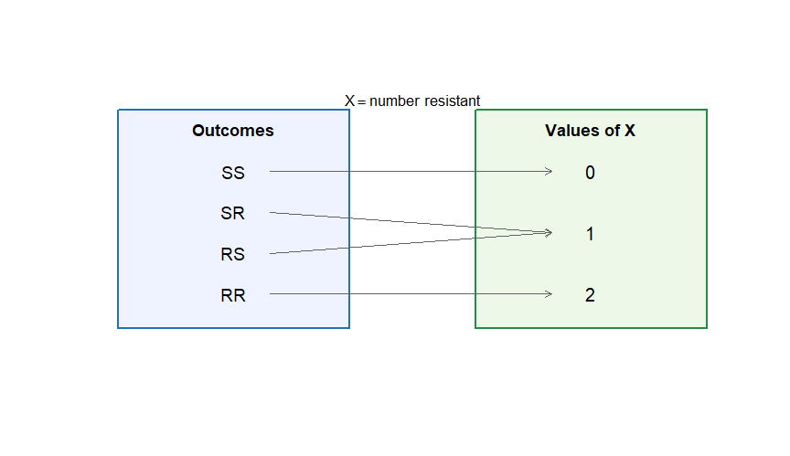
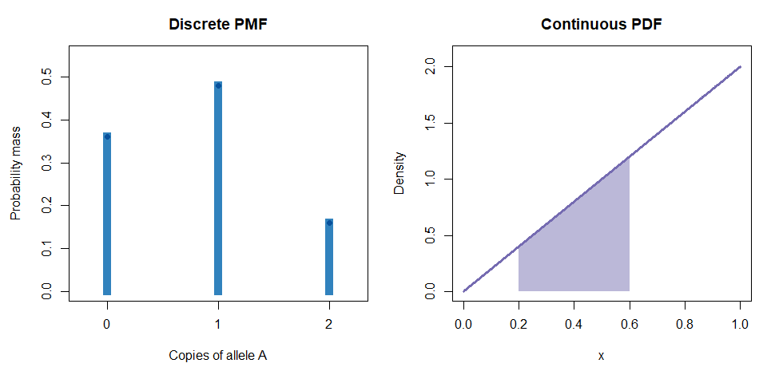
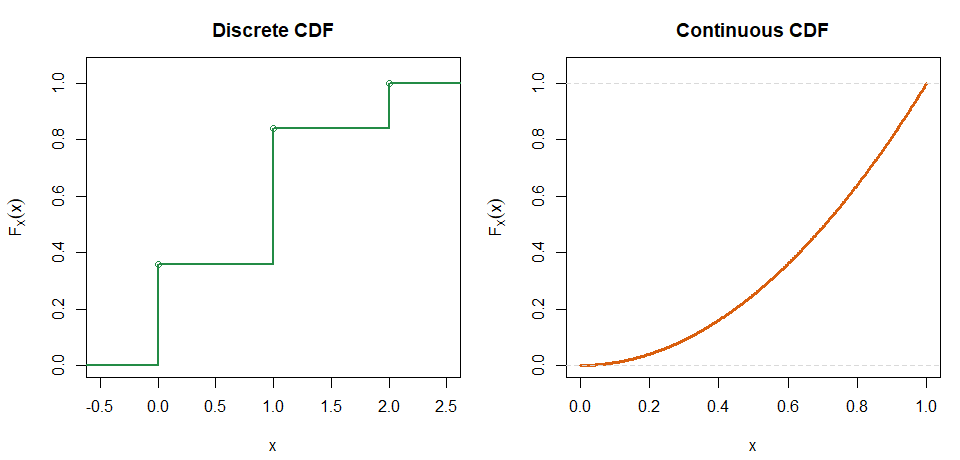
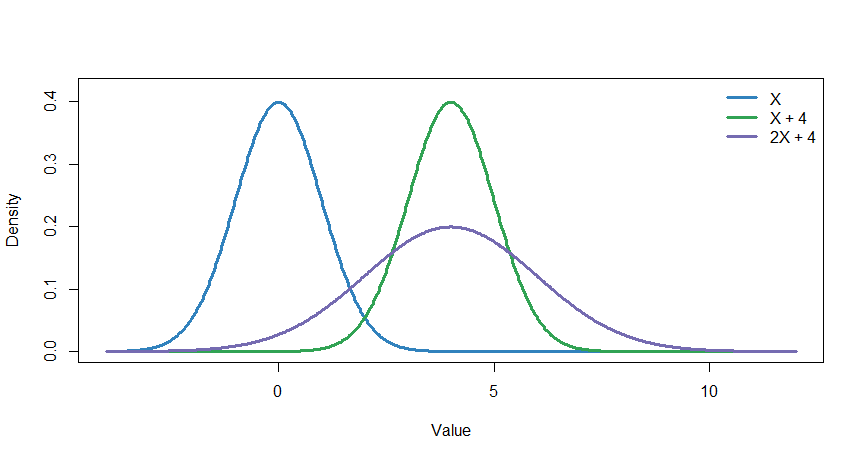
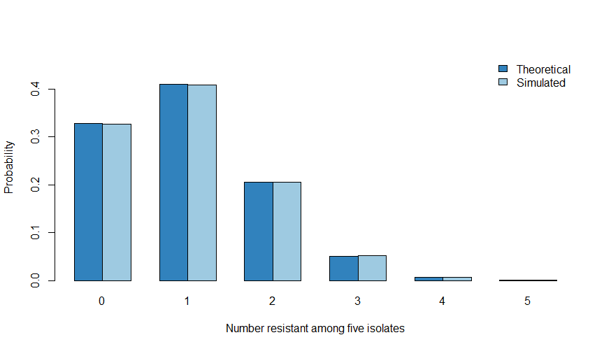

Chapter 13: Random Variables and Distribution Functions
================
Sandeep Singh

- [1. Where this chapter fits](#1-where-this-chapter-fits)
- [2. A random variable is a numerical
  rule](#2-a-random-variable-is-a-numerical-rule)
  - [2.1 Random variable versus observed
    value](#21-random-variable-versus-observed-value)
- [3. Support: which values are
  possible?](#3-support-which-values-are-possible)
  - [3.1 Why support matters](#31-why-support-matters)
- [4. Discrete, continuous, and mixed
  variables](#4-discrete-continuous-and-mixed-variables)
  - [4.1 Discrete random variables](#41-discrete-random-variables)
  - [4.2 Continuous random variables](#42-continuous-random-variables)
  - [4.3 Mixed random variables](#43-mixed-random-variables)
- [5. Probability mass functions](#5-probability-mass-functions)
  - [5.1 Conditions for a valid PMF](#51-conditions-for-a-valid-pmf)
  - [5.2 Worked example: copies of an
    allele](#52-worked-example-copies-of-an-allele)
  - [5.3 Adding probability masses](#53-adding-probability-masses)
- [6. Probability density functions](#6-probability-density-functions)
  - [6.1 Density is not exact-value
    probability](#61-density-is-not-exact-value-probability)
  - [6.2 Worked example: a simple triangular
    density](#62-worked-example-a-simple-triangular-density)
- [7. Visual comparison of probability mass and
  density](#7-visual-comparison-of-probability-mass-and-density)
- [8. The cumulative distribution
  function](#8-the-cumulative-distribution-function)
  - [8.1 Properties of every CDF](#81-properties-of-every-cdf)
  - [8.2 Discrete CDF](#82-discrete-cdf)
  - [8.3 Continuous CDF](#83-continuous-cdf)
  - [8.4 Obtaining probabilities from a
    CDF](#84-obtaining-probabilities-from-a-cdf)
- [9. Survival functions and upper-tail
  probability](#9-survival-functions-and-upper-tail-probability)
- [10. Quantiles: going from probability to a
  value](#10-quantiles-going-from-probability-to-a-value)
  - [10.1 Continuous example](#101-continuous-example)
  - [10.2 Discrete quantiles may jump](#102-discrete-quantiles-may-jump)
- [11. Expected value](#11-expected-value)
  - [11.1 Discrete expectation](#111-discrete-expectation)
  - [11.2 Continuous expectation](#112-continuous-expectation)
  - [11.3 Expectation is not always the most typical
    value](#113-expectation-is-not-always-the-most-typical-value)
- [12. Expected value of a function](#12-expected-value-of-a-function)
  - [12.1 Worked discrete example](#121-worked-discrete-example)
- [13. Variance and standard
  deviation](#13-variance-and-standard-deviation)
  - [13.1 Hand calculation for allele
    copies](#131-hand-calculation-for-allele-copies)
  - [13.2 Why variance uses squared
    distances](#132-why-variance-uses-squared-distances)
- [14. Linear transformations](#14-linear-transformations)
  - [14.1 Why adding a constant does not change
    variance](#141-why-adding-a-constant-does-not-change-variance)
  - [14.2 Why multiplying changes variance by
    $b^2$](#142-why-multiplying-changes-variance-by-b2)
  - [14.3 Worked example: unit
    conversion](#143-worked-example-unit-conversion)
- [15. Standardization](#15-standardization)
- [16. Indicator random variables](#16-indicator-random-variables)
  - [16.1 Counts are sums of
    indicators](#161-counts-are-sums-of-indicators)
- [17. Linearity of expectation](#17-linearity-of-expectation)
- [18. R’s distribution-function
  system](#18-rs-distribution-function-system)
  - [18.1 Discrete illustration](#181-discrete-illustration)
  - [18.2 Continuous illustration](#182-continuous-illustration)
  - [18.3 Lower and upper tails](#183-lower-and-upper-tails)
  - [18.4 Log probabilities](#184-log-probabilities)
- [19. Theoretical, empirical, and simulated
  distributions](#19-theoretical-empirical-and-simulated-distributions)
  - [19.1 Theoretical distribution](#191-theoretical-distribution)
  - [19.2 Empirical distribution](#192-empirical-distribution)
  - [19.3 Simulated distribution](#193-simulated-distribution)
  - [19.4 Simulation error is
    expected](#194-simulation-error-is-expected)
- [20. Choosing and checking a probability
  model](#20-choosing-and-checking-a-probability-model)
  - [20.1 Support check](#201-support-check)
  - [20.2 Shape check](#202-shape-check)
  - [20.3 Mean-variance check](#203-mean-variance-check)
  - [20.4 Independence check](#204-independence-check)
- [21. Common mistakes](#21-common-mistakes)
  - [Mistake 1: confusing outcomes, random variables, and observed
    values](#mistake-1-confusing-outcomes-random-variables-and-observed-values)
  - [Mistake 2: ignoring support](#mistake-2-ignoring-support)
  - [Mistake 3: interpreting density as
    probability](#mistake-3-interpreting-density-as-probability)
  - [Mistake 4: forgetting endpoint
    differences](#mistake-4-forgetting-endpoint-differences)
  - [Mistake 5: treating an expected value as a guaranteed
    observation](#mistake-5-treating-an-expected-value-as-a-guaranteed-observation)
  - [Mistake 6: assuming standardization creates
    Normality](#mistake-6-assuming-standardization-creates-normality)
  - [Mistake 7: assuming means and variances transform
    identically](#mistake-7-assuming-means-and-variances-transform-identically)
  - [Mistake 8: expecting simulation to match theory
    exactly](#mistake-8-expecting-simulation-to-match-theory-exactly)
- [22. Worked synthesis example](#22-worked-synthesis-example)
  - [Step 1: validate the PMF](#step-1-validate-the-pmf)
  - [Step 2: calculate a probability](#step-2-calculate-a-probability)
  - [Step 3: construct the CDF](#step-3-construct-the-cdf)
  - [Step 4: calculate the mean](#step-4-calculate-the-mean)
  - [Step 5: calculate the variance](#step-5-calculate-the-variance)
- [23. Practice exercises](#23-practice-exercises)
  - [23.1 Basic](#231-basic)
  - [23.2 Intermediate](#232-intermediate)
  - [23.3 Advanced](#233-advanced)
- [24. Mini-project: building a distribution from
  scratch](#24-mini-project-building-a-distribution-from-scratch)
- [25. Chapter summary](#25-chapter-summary)
- [26. Competency checklist](#26-competency-checklist)
- [27. Glossary](#27-glossary)
- [References](#references)

<script>
window.MathJax = {
  tex: {
    inlineMath: [['$', '$'], ['\\(', '\\)']],
    displayMath: [['$$', '$$'], ['\\[', '\\]']],
    processEscapes: true
  }
};
</script>

<script
  id="MathJax-script"
  async
  src="https://cdnjs.cloudflare.com/ajax/libs/mathjax/3.2.0/es5/tex-mml-chtml.js">
</script>

<!-- Suggested filename: Chapter_13_Random_Variables_and_Distribution_Functions.Rmd -->

# 1. Where this chapter fits

Chapter 12 introduced probability rules and the distinction between
discrete and continuous random variables. We now develop the
mathematical tools shared by nearly every probability distribution.

The aim is not to memorize a long list of named distributions. Instead,
we first learn a common language:

- **support** tells us which values are possible;
- a **PMF** describes discrete probability masses;
- a **PDF** describes continuous probability density;
- a **CDF** describes accumulated probability;
- a **quantile function** converts probability back into a value;
- **expectation** describes long-run centre; and
- **variance** describes spread.

Once these concepts are secure, Bernoulli, Binomial, Poisson, Normal,
and other distributions become variations on a familiar framework.

# 2. A random variable is a numerical rule

A **random variable** is a function that assigns a numerical value to
every outcome in a sample space.

Suppose we test two bacterial isolates. The sample space is:

$$\Omega=\{SS,SR,RS,RR\},$$

where `S` means susceptible and `R` means resistant.

Define:

$$X=\text{number of resistant isolates}.$$

Then:

$$X(SS)=0,\quad X(SR)=1,\quad X(RS)=1,\quad X(RR)=2.$$

Two different outcomes, `SR` and `RS`, produce the same numerical value.
A random variable can therefore simplify a complicated sample space into
the numerical feature we want to study.

``` r
plot(
  NA, xlim = c(0, 12), ylim = c(0, 8),
  xlab = "", ylab = "", axes = FALSE
)

rect(0.4, 0.8, 4.8, 7.2, col = "#EFF3FF", border = "#2171B5", lwd = 2)
rect(7.2, 0.8, 11.6, 7.2, col = "#EDF8E9", border = "#238B45", lwd = 2)
text(2.6, 6.65, "Outcomes", font = 2, cex = 1.15)
text(9.4, 6.65, "Values of X", font = 2, cex = 1.15)

outcome_y <- c(5.4, 4.2, 3.0, 1.8)
value_y <- c(5.4, 3.6, 1.8)
text(2.6, outcome_y, c("SS", "SR", "RS", "RR"), cex = 1.2)
text(9.4, value_y, c("0", "1", "2"), cex = 1.25)

arrows(3.3, 5.4, 8.65, 5.4, length = 0.08, col = "#636363")
arrows(3.3, 4.2, 8.65, 3.6, length = 0.08, col = "#636363")
arrows(3.3, 3.0, 8.65, 3.6, length = 0.08, col = "#636363")
arrows(3.3, 1.8, 8.65, 1.8, length = 0.08, col = "#636363")
text(6.0, 7.5, expression(X == "number resistant"), cex = 1.05)
```

<div class="figure" style="text-align: center">


<p class="caption">

A random variable maps outcomes in the sample space to numerical values.
</p>

</div>

## 2.1 Random variable versus observed value

We conventionally use:

- uppercase $X$ for the random variable; and
- lowercase $x$ for a possible or observed value.

Thus:

$$P(X=x)$$

means the probability that random variable $X$ takes the value $x$.

If we observed one resistant isolate, the observed value is $x=1$. The
random variable $X$ is the rule defined before the observation.

# 3. Support: which values are possible?

The **support** of a random variable is the set of values it can take
with non-zero probability or density. We write it as $\mathcal S_X$.

For the number resistant among two isolates:

$$\mathcal S_X=\{0,1,2\}.$$

Support provides an immediate check on whether a probability model is
scientifically sensible.

| Variable | Possible support | Important restriction |
|----|----|----|
| Disease indicator | $\{0,1\}$ | Only two outcomes |
| Colony count | $\{0,1,2,\ldots\}$ | No negative or fractional counts |
| Number responding among $n$ | $\{0,1,\ldots,n\}$ | Cannot exceed $n$ |
| Temperature | Often an interval of real numbers | Depends on physical setting |
| Survival time | $[0,\infty)$ | Cannot be negative |
| Proportion | $[0,1]$ | Bounded by 0 and 1 |

## 3.1 Why support matters

A Normal distribution allows negative and arbitrarily large positive
values. It may be reasonable for some measurements but unsuitable for a
small non-negative count. A distribution that assigns probability to
impossible values can produce misleading results even if its curve
appears visually convenient.

# 4. Discrete, continuous, and mixed variables

## 4.1 Discrete random variables

A **discrete random variable** has a finite or countably infinite set of
possible values.

Examples include:

- mutation count in a genomic region;
- number of treatment responders;
- number of hospital admissions; and
- sequencing reads assigned to a gene.

The values can be listed, at least in principle:

$$0,1,2,3,\ldots$$

## 4.2 Continuous random variables

A **continuous random variable** can take any value in an interval.

Examples include:

- cell diameter;
- protein concentration;
- systolic blood pressure; and
- time until relapse.

Even if an instrument reports one decimal place, the underlying quantity
can still be continuous.

## 4.3 Mixed random variables

Some variables contain both a discrete mass and a continuous component.
For example, a laboratory measurement may have:

- a positive probability of being exactly zero because a substance is
  undetectable; and
- a continuum of positive measured values when it is detected.

Such a variable is **mixed**. Standard purely discrete or purely
continuous models may not capture it adequately.

| Feature | Discrete | Continuous | Mixed |
|----|----|----|----|
| Possible values | Countable | Interval or intervals | Exact masses plus continuum |
| Exact-value probability | May be positive | Zero | Positive at mass points |
| Main representation | PMF | PDF | Masses and density |
| Example | Colony count | Cell size | Zero-inflated concentration |

# 5. Probability mass functions

For a discrete random variable, the **probability mass function** is:

$$p_X(x)=P(X=x).$$

The subscript reminds us that this is the PMF of $X$. We often write
simply $p(x)$ when the variable is clear.

## 5.1 Conditions for a valid PMF

A function is a valid PMF if:

$$p_X(x)\geq0\quad\text{for every }x$$

and

$$\sum_{x\in\mathcal S_X}p_X(x)=1.$$

## 5.2 Worked example: copies of an allele

For a diploid autosomal locus, let $X$ be the number of copies of allele
`A`. Suppose:

| Genotype | $X$ | Probability |
|----------|----:|------------:|
| `aa`     |   0 |        0.36 |
| `Aa`     |   1 |        0.48 |
| `AA`     |   2 |        0.16 |

First, we verify the total:

$$0.36+0.48+0.16=1.00.$$

All values are non-negative, so this is a valid PMF.

The probability of at least one copy of `A` is:

$$\begin{aligned}
P(X\geq1)
&=P(X=1)+P(X=2)\\
&=0.48+0.16\\
&=0.64.
\end{aligned}$$

Using the complement:

$$P(X\geq1)=1-P(X=0)=1-0.36=0.64.$$

``` r
allele_distribution <- data.frame(
  genotype = c("aa", "Aa", "AA"),
  allele_copies = 0:2,
  probability = c(0.36, 0.48, 0.16)
)

total_probability <- sum(allele_distribution$probability)

p_at_least_one <-
  sum(
    allele_distribution$probability[
      allele_distribution$allele_copies >= 1
    ]
  )

cat(
  knitr::kable(
    allele_distribution,
    format = "pipe",
    digits = 2,
    row.names = FALSE,
    col.names = c(
      "Genotype",
      "Allele copies",
      "Probability"
    ),
    caption = "Genotype distribution according to the number of A alleles."
  ),
  sep = "\n"
)
```

| Genotype | Allele copies | Probability |
|:---------|--------------:|------------:|
| aa       |             0 |        0.36 |
| Aa       |             1 |        0.48 |
| AA       |             2 |        0.16 |

Genotype distribution according to the number of A alleles.

``` r
cat("\n\n")
```

``` r
cat(
  "**Sum of probabilities:** ",
  sprintf("%.2f", total_probability),
  "\n\n",
  sep = ""
)
```

**Sum of probabilities:** 1.00

``` r
cat(
  "**Probability of at least one A allele:** ",
  sprintf("%.2f", p_at_least_one),
  "\n\n",
  sep = ""
)
```

**Probability of at least one A allele:** 0.64

## 5.3 Adding probability masses

For any set $A$ of possible discrete values:

$$P(X\in A)=\sum_{x\in A}p_X(x).$$

Probabilities of discrete events are obtained by adding the masses at
the relevant values.

# 6. Probability density functions

For a continuous random variable, a **probability density function**
$f_X(x)$ describes how probability is distributed across the support.

It must satisfy:

$$f_X(x)\geq0$$

and

$$\int_{-\infty}^{\infty}f_X(x)\,dx=1.$$

Probability is the area under the curve:

$$P(a\leq X\leq b)=\int_a^bf_X(x)\,dx.$$

## 6.1 Density is not exact-value probability

For a continuous variable:

$$P(X=x)=0.$$

The height $f_X(x)$ is a density, not the probability of observing
exactly $x$. Therefore, a density height may be greater than 1 as long
as the total area is 1.

## 6.2 Worked example: a simple triangular density

Consider:

$$f_X(x)=
\begin{cases}
2x, & 0\leq x\leq1,\\
0, & \text{otherwise}.
\end{cases}$$

To verify that it is a valid density:

$$\int_0^1 2x\,dx=[x^2]_0^1=1^2-0^2=1.$$

Now calculate $P(0.2\leq X\leq0.6)$:

$$\begin{aligned}
P(0.2\leq X\leq0.6)
&=\int_{0.2}^{0.6}2x\,dx\\
&=[x^2]_{0.2}^{0.6}\\
&=0.6^2-0.2^2\\
&=0.36-0.04\\
&=0.32.
\end{aligned}$$

``` r
integrate(function(x) 2 * x, lower = 0, upper = 1)
```

    ## 1 with absolute error < 1.1e-14

``` r
integrate(function(x) 2 * x, lower = 0.2, upper = 0.6)
```

    ## 0.32 with absolute error < 3.6e-15

# 7. Visual comparison of probability mass and density

``` r
old_par <- par(mfrow = c(1, 2), mar = c(4.3, 4.5, 3, 1))

plot(
  allele_distribution$allele_copies,
  allele_distribution$probability,
  type = "h", lwd = 10, lend = 2,
  col = "#3182BD", xaxt = "n",
  xlab = "Copies of allele A", ylab = "Probability mass",
  xlim = c(-0.25, 2.25), ylim = c(0, 0.55),
  main = "Discrete PMF"
)
axis(1, at = allele_distribution$allele_copies)
points(
  allele_distribution$allele_copies,
  allele_distribution$probability,
  pch = 19, col = "#08519C"
)

x_tri <- seq(0, 1, length.out = 500)
plot(
  x_tri, 2 * x_tri, type = "l", lwd = 3,
  col = "#756BB1", xlab = "x", ylab = "Density",
  xlim = c(0, 1), ylim = c(0, 2.1),
  main = "Continuous PDF"
)
shade_x <- x_tri[x_tri >= 0.2 & x_tri <= 0.6]
polygon(
  c(0.2, shade_x, 0.6),
  c(0, 2 * shade_x, 0),
  col = adjustcolor("#9E9AC8", alpha.f = 0.70),
  border = NA
)
lines(x_tri, 2 * x_tri, lwd = 3, col = "#756BB1")
```

<div class="figure" style="text-align: center">


<p class="caption">

A PMF assigns probability to separate values; a PDF represents
probability through area.
</p>

</div>

``` r
par(old_par)
```

# 8. The cumulative distribution function

The **cumulative distribution function** is defined for every random
variable:

$$F_X(x)=P(X\leq x).$$

This single definition works for discrete, continuous, and mixed
distributions.

## 8.1 Properties of every CDF

Every valid CDF:

1.  takes values between 0 and 1;
2.  never decreases as $x$ increases;
3.  approaches 0 as $x\to-\infty$;
4.  approaches 1 as $x\to\infty$; and
5.  is right-continuous.

## 8.2 Discrete CDF

For a discrete variable:

$$F_X(x)=\sum_{t\leq x}p_X(t).$$

For the allele-copy example:

|         $x$ | $F_X(x)$ |
|------------:|---------:|
|       $x<0$ |        0 |
| $0\leq x<1$ |     0.36 |
| $1\leq x<2$ |     0.84 |
|    $x\geq2$ |     1.00 |

The jumps equal the probability masses.

``` r
amplified_x <- 0:3
amplified_p <- c(0.01, 0.09, 0.36, 0.54)

amplified_mean <- sum(amplified_x * amplified_p)
amplified_ex2 <- sum(amplified_x^2 * amplified_p)
amplified_variance <- amplified_ex2 - amplified_mean^2

amplified_distribution <- data.frame(
  Copy_number = amplified_x,
  Probability = amplified_p,
  Cumulative_probability = cumsum(amplified_p)
)

cat(
  knitr::kable(
    amplified_distribution,
    format = "pipe",
    digits = 2,
    row.names = FALSE,
    caption = "Probability distribution for the amplified copy number."
  ),
  sep = "\n"
)
```

| Copy_number | Probability | Cumulative_probability |
|------------:|------------:|-----------------------:|
|           0 |        0.01 |                   0.01 |
|           1 |        0.09 |                   0.10 |
|           2 |        0.36 |                   0.46 |
|           3 |        0.54 |                   1.00 |

Probability distribution for the amplified copy number.

``` r
cat("\n\n")
```

``` r
cat(
  "**Expected value:** ",
  sprintf("%.2f", amplified_mean),
  "\n\n",
  sep = ""
)
```

**Expected value:** 2.43

``` r
cat(
  "**Variance:** ",
  sprintf("%.4f", amplified_variance),
  "\n\n",
  sep = ""
)
```

**Variance:** 0.4851

## 8.3 Continuous CDF

For a continuous variable:

$$F_X(x)=\int_{-\infty}^{x}f_X(t)\,dt.$$

For the triangular density on $[0,1]$:

$$F_X(x)=
\begin{cases}
0, & x<0,\\
x^2, & 0\leq x\leq1,\\
1, & x>1.
\end{cases}$$

The interval probability is:

$$P(0.2<X\leq0.6)=F_X(0.6)-F_X(0.2)=0.36-0.04=0.32.$$

## 8.4 Obtaining probabilities from a CDF

For $a<b$:

$$P(a<X\leq b)=F_X(b)-F_X(a).$$

For an upper tail:

$$P(X>x)=1-F_X(x).$$

For a discrete integer-valued variable:

$$P(X\geq k)=1-F_X(k-1).$$

The subtraction of 1 in the discrete expression is essential because
$P(X=k)$ can be positive.

``` r
old_par <- par(
  mfrow = c(1, 2),
  mar = c(4.3, 4.5, 3, 1)
)

allele_x <- allele_distribution$allele_copies
allele_cdf <- cumsum(allele_distribution$probability)

discrete_cdf <- stepfun(
  x = allele_x,
  y = c(0, allele_cdf)
)
plot(
  discrete_cdf,
  verticals = TRUE, do.points = TRUE,
  xlim = c(-0.5, 2.5), ylim = c(0, 1.05),
  xlab = "Copies of allele A", ylab = expression(F[X](x)),
  main = "Discrete CDF", col = "#238B45", lwd = 2
)

x_tri_cdf <- seq(0, 1, length.out = 500)
plot(
  x_tri_cdf, x_tri_cdf^2, type = "l", lwd = 3,
  col = "#D95F0E", xlab = "x", ylab = expression(F[X](x)),
  xlim = c(0, 1), ylim = c(0, 1.05), main = "Continuous CDF"
)
abline(h = c(0, 1), col = "grey85", lty = 2)
```

<div class="figure" style="text-align: center">


<p class="caption">

A discrete CDF jumps at supported values, whereas this continuous CDF
changes smoothly.
</p>

</div>

``` r
par(old_par)
```

# 9. Survival functions and upper-tail probability

The **survival function** is:

$$S_X(x)=P(X>x)=1-F_X(x).$$

The word *survival* comes from time-to-event analysis, but the function
is useful for any upper-tail probability.

Examples include:

- probability that survival time exceeds 24 months;
- probability that expression exceeds a threshold;
- probability that a colony count is above a contamination limit; and
- probability that waiting time is longer than a target.

For the triangular example:

$$P(X>0.8)=1-F_X(0.8)=1-0.8^2=0.36.$$

``` r
1 - 0.8^2
```

    ## [1] 0.36

# 10. Quantiles: going from probability to a value

The $p$-quantile is the value at which the CDF reaches probability $p$.
A careful general definition is:

$$Q(p)=\inf\{x:F_X(x)\geq p\},\qquad0<p<1.$$

In plain language, it is the smallest value whose cumulative probability
is at least $p$.

Important quantiles include:

- $Q(0.25)$: first quartile;
- $Q(0.50)$: median; and
- $Q(0.75)$: third quartile.

## 10.1 Continuous example

For the triangular distribution, $F_X(x)=x^2$. Set $F_X(x)=p$:

$$x^2=p.$$

Therefore:

$$Q(p)=\sqrt p.$$

The median is:

$$Q(0.5)=\sqrt{0.5}=0.7071.$$

``` r
sqrt(c(first_quartile = 0.25, median = 0.50, third_quartile = 0.75))
```

    ## first_quartile         median third_quartile 
    ##      0.5000000      0.7071068      0.8660254

## 10.2 Discrete quantiles may jump

For discrete distributions, the CDF can jump over the requested
probability. The quantile is the first supported value whose cumulative
probability is at least the target.

For the allele-copy PMF:

- $F(0)=0.36$;
- $F(1)=0.84$; and
- $F(2)=1.00$.

Therefore, the median is 1 because 1 is the smallest value for which
$F(x)\geq0.5$.

# 11. Expected value

The **expected value** is the probability-weighted long-run mean of a
random variable.

## 11.1 Discrete expectation

For a discrete variable:

$$E(X)=\sum_xx\,p_X(x).$$

For the allele-copy example:

$$\begin{aligned}
E(X)
&=(0)(0.36)+(1)(0.48)+(2)(0.16)\\
&=0+0.48+0.32\\
&=0.80.
\end{aligned}$$

The value 0.80 is a long-run mean. One person cannot carry 0.80 copies
at this locus.

``` r
mu_alleles <- with(
  allele_distribution,
  sum(allele_copies * probability)
)
mu_alleles
```

    ## [1] 0.8

## 11.2 Continuous expectation

For a continuous variable:

$$E(X)=\int_{-\infty}^{\infty}x f_X(x)\,dx.$$

For the triangular density $f_X(x)=2x$ on $[0,1]$:

$$\begin{aligned}
E(X)
&=\int_0^1x(2x)\,dx\\
&=\int_0^12x^2\,dx\\
&=\left[\frac{2x^3}{3}\right]_0^1\\
&=\frac{2}{3}.
\end{aligned}$$

``` r
integrate(function(x) x * (2 * x), lower = 0, upper = 1)
```

    ## 0.6666667 with absolute error < 7.4e-15

## 11.3 Expectation is not always the most typical value

For a highly skewed distribution, the mean can be far from the most
common or most typical observations. Expectation is a mathematical
centre, but its scientific interpretation depends on distribution shape.

# 12. Expected value of a function

Sometimes we need the expected value of $g(X)$, not only $X$.

For a discrete variable:

$$E[g(X)]=\sum_xg(x)p_X(x).$$

For a continuous variable:

$$E[g(X)]=\int_{-\infty}^{\infty}g(x)f_X(x)\,dx.$$

## 12.1 Worked discrete example

Suppose the laboratory cost associated with $X$ allele copies is:

$$g(X)=100+50X^2.$$

Then:

$$\begin{aligned}
E[g(X)]
&=g(0)(0.36)+g(1)(0.48)+g(2)(0.16)\\
&=100(0.36)+150(0.48)+300(0.16)\\
&=36+72+48\\
&=156.
\end{aligned}$$

``` r
cost_function <- function(x) 100 + 50 * x^2
expected_cost <- with(
  allele_distribution,
  sum(cost_function(allele_copies) * probability)
)
expected_cost
```

    ## [1] 156

In general:

$$E[g(X)]\neq g(E[X]).$$

Equality holds for linear functions but not generally for nonlinear
functions such as $X^2$.

# 13. Variance and standard deviation

The variance is the expected squared distance from the mean:

$$\operatorname{Var}(X)=E[(X-\mu)^2].$$

For a discrete variable:

$$\operatorname{Var}(X)=\sum_x(x-\mu)^2p_X(x).$$

For a continuous variable:

$$\operatorname{Var}(X)=\int_{-\infty}^{\infty}(x-\mu)^2f_X(x)\,dx.$$

An equivalent formula is:

$$\operatorname{Var}(X)=E(X^2)-[E(X)]^2.$$

The standard deviation is:

$$\operatorname{SD}(X)=\sqrt{\operatorname{Var}(X)}.$$

## 13.1 Hand calculation for allele copies

We already found $\mu=0.80$. Therefore:

$$\begin{aligned}
E(X^2)
&=0^2(0.36)+1^2(0.48)+2^2(0.16)\\
&=0+0.48+0.64\\
&=1.12.
\end{aligned}$$

Then:

$$\operatorname{Var}(X)=1.12-(0.80)^2=1.12-0.64=0.48.$$

Finally:

$$\operatorname{SD}(X)=\sqrt{0.48}=0.6928.$$

``` r
ex2 <- with(
  allele_distribution,
  sum(allele_copies^2 * probability)
)
variance_alleles <- ex2 - mu_alleles^2
sd_alleles <- sqrt(variance_alleles)

c(
  mean = mu_alleles,
  expected_x_squared = ex2,
  variance = variance_alleles,
  standard_deviation = sd_alleles
)
```

    ##               mean expected_x_squared           variance standard_deviation 
    ##          0.8000000          1.1200000          0.4800000          0.6928203

## 13.2 Why variance uses squared distances

If ordinary signed deviations were averaged, negative and positive
deviations would cancel:

$$E(X-\mu)=0.$$

Squaring makes every contribution non-negative and gives greater weight
to large deviations. The square root returns the standard deviation to
the original measurement units.

# 14. Linear transformations

Suppose:

$$Y=a+bX.$$

Then:

$$E(Y)=a+bE(X)$$

and

$$\operatorname{Var}(Y)=b^2\operatorname{Var}(X).$$

Therefore:

$$\operatorname{SD}(Y)=|b|\operatorname{SD}(X).$$

## 14.1 Why adding a constant does not change variance

Adding $a$ shifts every value equally. Distances between values remain
unchanged, so spread does not change.

## 14.2 Why multiplying changes variance by $b^2$

Multiplying by $b$ multiplies each deviation by $b$. Squared deviations
are therefore multiplied by $b^2$.

## 14.3 Worked example: unit conversion

If temperature in Fahrenheit is:

$$F=32+\frac{9}{5}C,$$

and Celsius temperature has mean 20 and standard deviation 3, then:

$$E(F)=32+\frac95(20)=68$$

and

$$\operatorname{SD}(F)=\frac95(3)=5.4.$$

``` r
mean_c <- 20
sd_c <- 3

mean_f <- 32 + (9 / 5) * mean_c
sd_f <- abs(9 / 5) * sd_c
variance_f <- (9 / 5)^2 * sd_c^2

c(mean_f = mean_f, sd_f = sd_f, variance_f = variance_f)
```

    ##     mean_f       sd_f variance_f 
    ##      68.00       5.40      29.16

``` r
x_base <- seq(-4, 12, length.out = 800)
y_base <- dnorm(x_base, mean = 0, sd = 1)
y_shift <- dnorm(x_base, mean = 4, sd = 1)
y_scale <- dnorm(x_base, mean = 4, sd = 2)

plot(
  x_base, y_base, type = "l", lwd = 3, col = "#3182BD",
  xlab = "Value", ylab = "Density", ylim = c(0, 0.42)
)
lines(x_base, y_shift, lwd = 3, col = "#31A354")
lines(x_base, y_scale, lwd = 3, col = "#756BB1")
legend(
  "topright",
  legend = c("X", "X + 4", "2X + 4"),
  col = c("#3182BD", "#31A354", "#756BB1"),
  lwd = 3, bty = "n"
)
```

<div class="figure" style="text-align: center">


<p class="caption">

Adding a constant shifts a distribution; multiplying changes both
location and spread.
</p>

</div>

# 15. Standardization

Standardization expresses a value in standard-deviation units:

$$Z=\frac{X-\mu}{\sigma}.$$

If $E(X)=\mu$ and $\operatorname{SD}(X)=\sigma>0$, then:

$$E(Z)=0$$

and

$$\operatorname{SD}(Z)=1.$$

A standardized value of 1.5 means that the observation lies 1.5 standard
deviations above the mean. Standardization does not automatically make a
distribution Normal; it only changes its location and scale.

``` r
x_value <- 118
mu <- 100
sigma <- 12
z_value <- (x_value - mu) / sigma
z_value
```

    ## [1] 1.5

# 16. Indicator random variables

An **indicator random variable** records whether an event occurs:

$$I_A=
\begin{cases}
1, & \text{if event }A\text{ occurs},\\
0, & \text{otherwise}.
\end{cases}$$

If $P(A)=p$, then:

$$E(I_A)=1(p)+0(1-p)=p.$$

Also:

$$\operatorname{Var}(I_A)=p(1-p).$$

## 16.1 Counts are sums of indicators

Suppose $I_i=1$ when isolate $i$ is resistant and 0 otherwise. The total
number resistant among $n$ isolates is:

$$X=I_1+I_2+\cdots+I_n.$$

Using linearity of expectation:

$$E(X)=E(I_1)+\cdots+E(I_n).$$

If every isolate has resistance probability $p$:

$$E(X)=np.$$

This result does not require independence for the mean. Independence
becomes important when calculating variance and the full Binomial
distribution.

# 17. Linearity of expectation

For constants $a_1,\ldots,a_n$:

$$E\left(\sum_{i=1}^na_iX_i\right)
=\sum_{i=1}^na_iE(X_i).$$

Linearity of expectation holds whether or not the variables are
independent.

Variance behaves differently. For two variables:

$$\operatorname{Var}(X+Y)
=\operatorname{Var}(X)+\operatorname{Var}(Y)
+2\operatorname{Cov}(X,Y).$$

If $X$ and $Y$ are independent, their covariance is zero, and the
variances add.

# 18. R’s distribution-function system

R uses four standard prefixes:

| Prefix | Purpose | Input | Output |
|----|----|----|----|
| `d` | Mass or density | A value $x$ | PMF value or density height |
| `p` | Cumulative probability | A value $x$ | $P(X\leq x)$ |
| `q` | Quantile | A probability $p$ | Value corresponding to $p$ |
| `r` | Random generation | Number of observations | Simulated values |

## 18.1 Discrete illustration

For a Binomial model:

``` r
dbinom(2, size = 5, prob = 0.20)  # P(X = 2)
```

    ## [1] 0.2048

``` r
pbinom(2, size = 5, prob = 0.20)  # P(X <= 2)
```

    ## [1] 0.94208

``` r
qbinom(0.90, size = 5, prob = 0.20)
```

    ## [1] 2

``` r
rbinom(8, size = 5, prob = 0.20)
```

    ## [1] 1 3 1 1 1 2 2 0

The detailed Binomial model will be developed in its own chapter.

## 18.2 Continuous illustration

For a Normal model:

``` r
dnorm(110, mean = 100, sd = 15)  # Density, not P(X = 110)
```

    ## [1] 0.02129653

``` r
pnorm(110, mean = 100, sd = 15)  # P(X <= 110)
```

    ## [1] 0.7475075

``` r
qnorm(0.95, mean = 100, sd = 15)
```

    ## [1] 124.6728

``` r
rnorm(8, mean = 100, sd = 15)
```

    ## [1]  75.47732 106.92881  86.90452  85.52973 108.39614  79.08802 118.95806
    ## [8] 110.71505

## 18.3 Lower and upper tails

Most `p` functions return $P(X\leq x)$ by default. We can request the
upper tail directly:

``` r
pnorm(130, mean = 100, sd = 15, lower.tail = FALSE)
```

    ## [1] 0.02275013

Using `lower.tail = FALSE` is often numerically more accurate than
manually calculating `1 - pnorm(...)` for extremely small upper-tail
probabilities.

## 18.4 Log probabilities

Many R distribution functions offer `log = TRUE` or `log.p = TRUE`. Log
probabilities help avoid numerical underflow when probabilities are
extremely small.

``` r
dnorm(10, log = TRUE)
```

    ## [1] -50.91894

``` r
pnorm(10, lower.tail = FALSE, log.p = TRUE)
```

    ## [1] -53.23129

# 19. Theoretical, empirical, and simulated distributions

These terms are related but not identical.

## 19.1 Theoretical distribution

A theoretical distribution is a mathematical model defined by a support
and parameters. It describes what would happen across hypothetical
repetitions if the model assumptions were correct.

## 19.2 Empirical distribution

An empirical distribution is built from observed data. The empirical CDF
is:

$$\widehat F_n(x)=\frac{1}{n}\sum_{i=1}^nI(X_i\leq x).$$

It is the proportion of observations less than or equal to $x$.

## 19.3 Simulated distribution

A simulated distribution is obtained by generating values from a chosen
theoretical model. Simulation helps us understand sampling variation and
verify mathematical calculations.

``` r
n_sim <- 10000
simulated_x <- rbinom(n_sim, size = 5, prob = 0.20)
support_x <- 0:5
simulated_prob <- as.numeric(
  table(factor(simulated_x, levels = support_x)) / n_sim
)
theoretical_prob <- dbinom(support_x, size = 5, prob = 0.20)

comparison_matrix <- rbind(
  Theoretical = theoretical_prob,
  Simulated = simulated_prob
)

barplot(
  comparison_matrix,
  beside = TRUE,
  names.arg = support_x,
  col = c("#3182BD", "#9ECAE1"),
  xlab = "Number resistant among five isolates",
  ylab = "Probability",
  ylim = c(0, max(comparison_matrix) * 1.15)
)
legend(
  "topright",
  legend = rownames(comparison_matrix),
  fill = c("#3182BD", "#9ECAE1"), bty = "n"
)
```

<div class="figure" style="text-align: center">


<p class="caption">

A large simulation approaches the theoretical PMF but retains random
variation.
</p>

</div>

## 19.4 Simulation error is expected

The simulated proportions will not exactly equal theoretical
probabilities. The differences are Monte Carlo error. Increasing the
number of simulations usually reduces, but does not completely
eliminate, this random discrepancy.

# 20. Choosing and checking a probability model

A probability distribution is a scientific model, not merely a formula.

We should ask:

1.  What is the outcome type?
2.  What is its support?
3.  What process generates the values?
4.  Are observations independent or clustered?
5.  Is the rate or probability reasonably constant?
6.  Is there a fixed number of trials or a fixed exposure?
7.  Are there more zeros than expected?
8.  Is variability larger or smaller than the model allows?
9.  Are values rounded, truncated, or censored?
10. Does the model reproduce important features of the observed data?

## 20.1 Support check

The model should not assign substantial probability to scientifically
impossible values.

## 20.2 Shape check

Compare observed symmetry, skewness, tails, and modality with the
proposed model.

## 20.3 Mean-variance check

Some count distributions impose a particular mean-variance relationship.
Biological heterogeneity often produces more variation than a simple
model expects.

## 20.4 Independence check

Repeated measurements from the same person, cells from the same culture,
and related individuals are usually not independent. The marginal
distribution of one observation does not by itself solve dependence
among observations.

# 21. Common mistakes

## Mistake 1: confusing outcomes, random variables, and observed values

An outcome belongs to the sample space, a random variable maps outcomes
to numbers, and an observed value is one realized number.

## Mistake 2: ignoring support

A convenient curve is not automatically a suitable model. Impossible
negative counts or values beyond natural bounds indicate a support
mismatch.

## Mistake 3: interpreting density as probability

For a continuous variable, probability is area. `dnorm(x)` is not
$P(X=x)$.

## Mistake 4: forgetting endpoint differences

For a continuous variable, including an endpoint does not change
probability. For a discrete variable, it may change probability
substantially.

## Mistake 5: treating an expected value as a guaranteed observation

The expected value is a long-run weighted mean and may not itself be
observable.

## Mistake 6: assuming standardization creates Normality

Subtracting the mean and dividing by the standard deviation changes
location and scale, not distributional shape.

## Mistake 7: assuming means and variances transform identically

Under $Y=a+bX$, the mean becomes $a+bE(X)$, but variance becomes
$b^2\operatorname{Var}(X)$.

## Mistake 8: expecting simulation to match theory exactly

Finite simulations contain random error. Agreement should improve as the
simulation size grows.

# 22. Worked synthesis example

Let $X$ be the number of successfully amplified samples in a batch of
three. Suppose the PMF is:

|      $x$ |    0 |    1 |    2 |    3 |
|---------:|-----:|-----:|-----:|-----:|
| $P(X=x)$ | 0.01 | 0.09 | 0.36 | 0.54 |

## Step 1: validate the PMF

$$0.01+0.09+0.36+0.54=1.00.$$

## Step 2: calculate a probability

At least two amplify:

$$P(X\geq2)=0.36+0.54=0.90.$$

## Step 3: construct the CDF

$$F(0)=0.01,\quad F(1)=0.10,\quad F(2)=0.46,\quad F(3)=1.00.$$

## Step 4: calculate the mean

$$E(X)=0(0.01)+1(0.09)+2(0.36)+3(0.54)=2.43.$$

## Step 5: calculate the variance

$$E(X^2)=0^2(0.01)+1^2(0.09)+2^2(0.36)+3^2(0.54)=6.39.$$

$$\operatorname{Var}(X)=6.39-(2.43)^2=0.4851.$$

$$\operatorname{SD}(X)=\sqrt{0.4851}=0.6965.$$

``` r
amplified_x <- 0:3
amplified_p <- c(0.01, 0.09, 0.36, 0.54)

amplified_mean <- sum(amplified_x * amplified_p)
amplified_ex2 <- sum(amplified_x^2 * amplified_p)
amplified_variance <- amplified_ex2 - amplified_mean^2

amplified_summary <- data.frame(
  x = amplified_x,
  probability = amplified_p,
  cumulative_probability = cumsum(amplified_p)
)

probability_at_least_two <- sum(amplified_p[amplified_x >= 2])
amplified_sd <- sqrt(amplified_variance)

cat(
  knitr::kable(
    amplified_summary,
    format = "pipe",
    digits = 4,
    row.names = FALSE,
    col.names = c("x", "Probability", "Cumulative probability"),
    caption = "PMF and CDF for the number of successfully amplified samples."
  ),
  sep = "\n"
)
```

|   x | Probability | Cumulative probability |
|----:|------------:|-----------------------:|
|   0 |        0.01 |                   0.01 |
|   1 |        0.09 |                   0.10 |
|   2 |        0.36 |                   0.46 |
|   3 |        0.54 |                   1.00 |

PMF and CDF for the number of successfully amplified samples.

``` r
cat("\n\n")
```

``` r
cat("**Probability of at least two successes:** ",
    sprintf("%.2f", probability_at_least_two), "\n\n", sep = "")
```

**Probability of at least two successes:** 0.90

``` r
cat("**Expected value:** ", sprintf("%.2f", amplified_mean),
    "\n\n", sep = "")
```

**Expected value:** 2.43

``` r
cat("**Variance:** ", sprintf("%.4f", amplified_variance),
    "\n\n", sep = "")
```

**Variance:** 0.4851

``` r
cat("**Standard deviation:** ", sprintf("%.4f", amplified_sd),
    "\n\n", sep = "")
```

**Standard deviation:** 0.6965

# 23. Practice exercises

## 23.1 Basic

1.  Define a random variable for the number of positive tests among four
    samples. State its support.
2.  Classify each as discrete, continuous, or potentially mixed: number
    of reads, blood pressure, undetectable-or-positive concentration,
    and time to relapse.
3.  Explain the difference between a PMF and a PDF in one paragraph.
4.  If $F(5)=0.72$, calculate $P(X>5)$.
5.  Explain why the height of a PDF is not an exact-value probability.

## 23.2 Intermediate

1.  A random variable takes values 0, 1, and 2 with probabilities 0.25,
    0.50, and 0.25. Calculate its CDF, mean, variance, and standard
    deviation.
2.  For the triangular density in this chapter, calculate $P(X>0.5)$ by
    integration and by using the CDF.
3.  Derive the 90th percentile of the triangular distribution.
4.  If $Y=10+3X$, $E(X)=4$, and $\operatorname{Var}(X)=2$, calculate
    $E(Y)$, $\operatorname{Var}(Y)$, and $\operatorname{SD}(Y)$.
5.  Write R code using `pnorm()` to calculate an interval probability
    and an upper-tail probability.

## 23.3 Advanced

1.  Prove from the definition that $E(a+bX)=a+bE(X)$.
2.  Use indicator variables to show that the expected number of positive
    samples among $n$ samples is the sum of their individual positive
    probabilities, even if those probabilities differ.
3.  Construct an example showing that $E(X^2)\neq[E(X)]^2$.
4.  Simulate samples of sizes 50, 500, and 50,000 from the same
    distribution. Compare empirical means, variances, and CDFs with
    theoretical values.
5.  Give a biological example where a mixed distribution would be more
    realistic than a purely continuous distribution.

# 24. Mini-project: building a distribution from scratch

Consider the number of detectable microbial taxa in a simplified assay
with possible values $0,1,2,3,4$. Use the hypothetical probabilities:

$$(0.05,0.15,0.35,0.30,0.15).$$

Complete the following tasks:

1.  Define the random variable and its support.
2.  Verify that the probabilities form a valid PMF.
3.  Construct a data frame containing $x$, $p(x)$, and $F(x)$.
4.  Draw the PMF.
5.  Draw the CDF.
6.  Calculate $P(X=2)$, $P(X\leq2)$, $P(X>2)$, and $P(1\leq X\leq3)$.
7.  Calculate $E(X)$, $E(X^2)$, variance, and standard deviation by
    hand.
8.  Verify every calculation in R.
9.  Generate 10,000 simulated values using `sample()`.
10. Compare empirical and theoretical probabilities.
11. Transform the variable using $Y=5+10X$ and verify the mean and
    variance transformation rules.
12. Write a short interpretation suitable for a biological research
    report.

Starter code:

``` r
x <- 0:4
p <- c(0.05, 0.15, 0.35, 0.30, 0.15)

distribution_table <- data.frame(
  x = x,
  probability = p,
  cumulative_probability = cumsum(p)
)

stopifnot(
  all(p >= 0),
  isTRUE(all.equal(sum(p), 1))
)

mu_x <- sum(x * p)
ex2 <- sum(x^2 * p)
var_x <- ex2 - mu_x^2

set.seed(1301)
simulated_x <- sample(
  x = x,
  size = 10000,
  replace = TRUE,
  prob = p
)

empirical_probability <-
  table(factor(simulated_x, levels = x)) / length(simulated_x)

cbind(
  distribution_table,
  empirical_probability = as.numeric(empirical_probability)
)
```

# 25. Chapter summary

- A random variable maps outcomes to numerical values.
- The support defines which values are possible.
- Discrete variables use probability masses; continuous variables use
  probability densities.
- Mixed variables can contain both exact masses and a continuous
  component.
- The CDF $F_X(x)=P(X\leq x)$ provides a common description for every
  random variable.
- The survival function is $S_X(x)=1-F_X(x)$.
- Quantiles translate cumulative probabilities back into values.
- Expectation is a probability-weighted long-run mean.
- Variance measures expected squared distance from the mean.
- For $Y=a+bX$, the mean is $a+bE(X)$ and the variance is
  $b^2\operatorname{Var}(X)$.
- Indicator variables connect events, probabilities, and counts.
- R’s `d`, `p`, `q`, and `r` functions represent mass/density,
  cumulative probability, quantiles, and simulation.
- Theoretical, empirical, and simulated distributions answer related but
  different questions.
- A suitable distribution must match the support, biological mechanism,
  and dependence structure.

# 26. Competency checklist

We are ready to continue when we can:

- [ ] map a sample space to a random variable;
- [ ] state and assess a variable’s support;
- [ ] distinguish discrete, continuous, and mixed variables;
- [ ] validate and use a PMF;
- [ ] calculate probability as area under a PDF;
- [ ] construct and interpret a CDF;
- [ ] use a survival function and quantile function;
- [ ] calculate expectation, variance, and standard deviation;
- [ ] calculate the expectation of a transformed variable;
- [ ] apply linear transformation rules;
- [ ] use indicator variables to represent events and counts;
- [ ] use R’s `d`, `p`, `q`, and `r` functions; and
- [ ] compare theoretical and simulated results responsibly.

# 27. Glossary

| Term | Meaning |
|----|----|
| Random variable | Numerical function defined on outcomes |
| Realization | Observed value of a random variable |
| Support | Set of values a random variable can take |
| Discrete variable | Variable with countable possible values |
| Continuous variable | Variable taking values across an interval |
| Mixed variable | Variable with discrete masses and continuous density |
| PMF | Function assigning probability to each discrete value |
| PDF | Function whose area gives continuous probability |
| CDF | Function $F_X(x)=P(X\leq x)$ |
| Survival function | Upper-tail function $S_X(x)=P(X>x)$ |
| Quantile | Value associated with a cumulative probability |
| Expected value | Probability-weighted long-run mean |
| Variance | Expected squared distance from the mean |
| Standard deviation | Positive square root of variance |
| Indicator variable | Variable equal to 1 when an event occurs and 0 otherwise |
| Empirical distribution | Distribution constructed from observed data |
| Simulation | Random generation of values from a model |

# References

1.  Blitzstein, J. K., & Hwang, J. (2019). *Introduction to Probability*
    (2nd ed.). CRC Press.
2.  Casella, G., & Berger, R. L. (2002). *Statistical Inference* (2nd
    ed.). Duxbury.
3.  DeGroot, M. H., & Schervish, M. J. (2012). *Probability and
    Statistics* (4th ed.). Pearson.
4.  Kirkwood, B. R., & Sterne, J. A. C. (2003). *Essential Medical
    Statistics* (2nd ed.). Blackwell Science.
5.  Rice, J. A. (2007). *Mathematical Statistics and Data Analysis* (3rd
    ed.). Duxbury.
6.  Rosner, B. (2015). *Fundamentals of Biostatistics* (8th ed.).
    Cengage Learning.
7.  R Core Team. *R: A Language and Environment for Statistical
    Computing*. R Foundation for Statistical Computing.
    <https://www.R-project.org/>
8.  R Core Team. *The R Stats Package: Distribution Functions*.
    <https://stat.ethz.ch/R-manual/R-devel/library/stats/html/Distributions.html>
