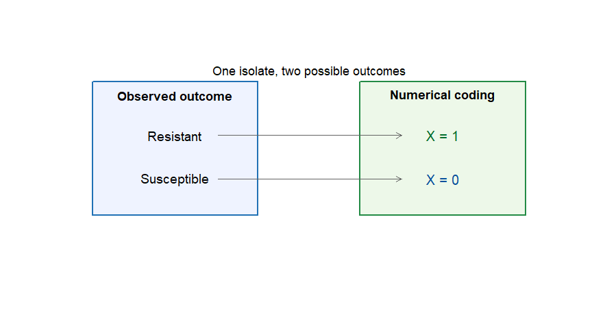
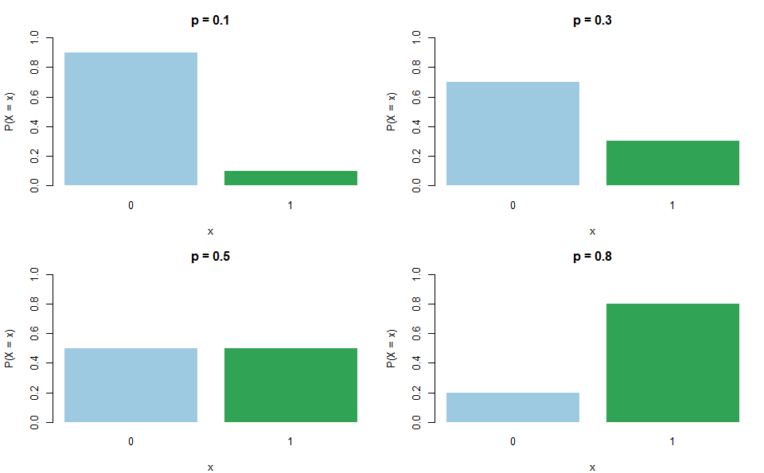
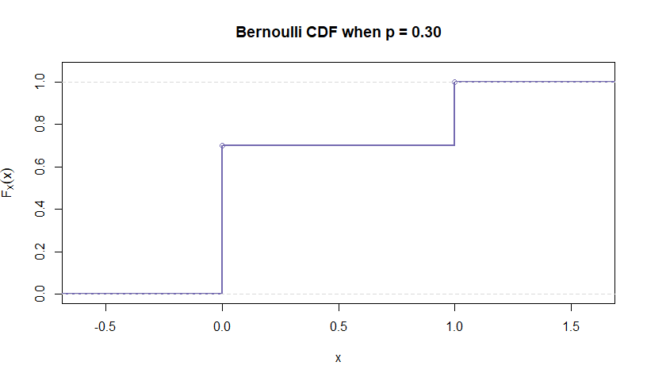
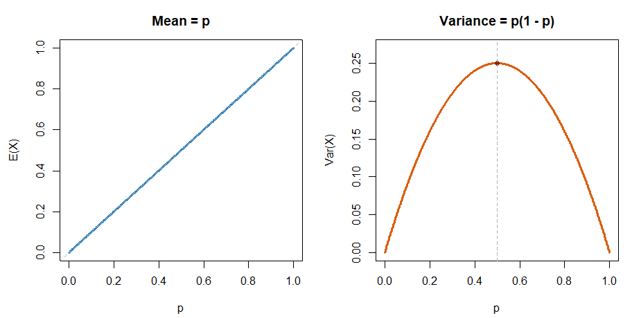
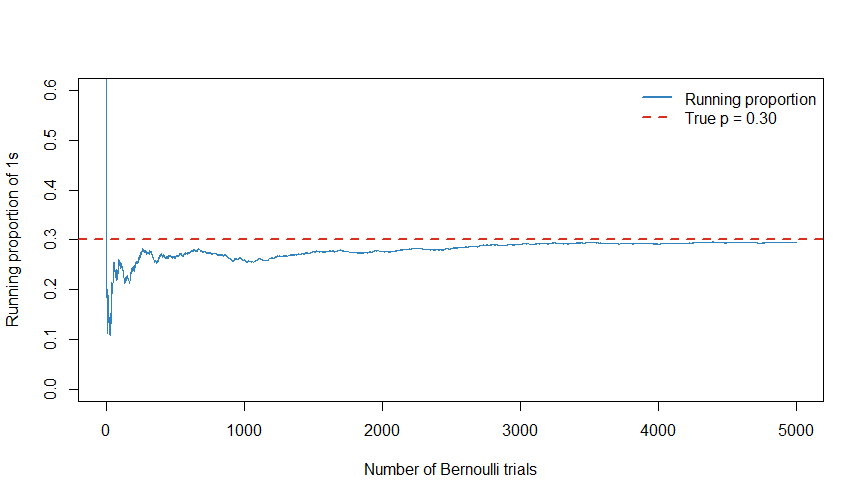

Chapter 14: The Bernoulli Distribution
================
Sandeep Singh

- [Learning objectives](#learning-objectives)
- [1. Why begin with the Bernoulli
  distribution?](#1-why-begin-with-the-bernoulli-distribution)
- [2. A Bernoulli trial](#2-a-bernoulli-trial)
- [3. “Success” does not necessarily mean something
  good](#3-success-does-not-necessarily-mean-something-good)
  - [3.1 Coding can be reversed](#31-coding-can-be-reversed)
- [4. The Bernoulli parameter](#4-the-bernoulli-parameter)
  - [4.1 Example: one resistant
    isolate](#41-example-one-resistant-isolate)
- [5. The Bernoulli probability mass
  function](#5-the-bernoulli-probability-mass-function)
  - [5.1 Why the compact formula
    works](#51-why-the-compact-formula-works)
  - [5.2 Verifying a valid PMF](#52-verifying-a-valid-pmf)
- [6. How the PMF changes with $p$](#6-how-the-pmf-changes-with-p)
- [7. The Bernoulli cumulative distribution
  function](#7-the-bernoulli-cumulative-distribution-function)
  - [7.1 Understanding the steps](#71-understanding-the-steps)
- [8. Expected value of a Bernoulli
  variable](#8-expected-value-of-a-bernoulli-variable)
  - [8.1 Interpretation](#81-interpretation)
- [9. Variance and standard
  deviation](#9-variance-and-standard-deviation)
  - [9.1 Worked calculation](#91-worked-calculation)
- [10. How $p$ controls the mean and
  variance](#10-how-p-controls-the-mean-and-variance)
  - [10.1 Showing the maximum
    mathematically](#101-showing-the-maximum-mathematically)
- [11. Bernoulli variables are indicator
  variables](#11-bernoulli-variables-are-indicator-variables)
  - [11.1 Example: threshold
    indicator](#111-example-threshold-indicator)
  - [11.2 Creating indicators in R](#112-creating-indicators-in-r)
- [12. Probability, odds, and
  log-odds](#12-probability-odds-and-log-odds)
  - [12.1 From probability to odds](#121-from-probability-to-odds)
  - [12.2 From odds to probability](#122-from-odds-to-probability)
  - [12.3 Log-odds](#123-log-odds)
- [13. Using the Bernoulli distribution in
  R](#13-using-the-bernoulli-distribution-in-r)
  - [13.1 Probability mass with
    `dbinom()`](#131-probability-mass-with-dbinom)
  - [13.2 Cumulative probability with
    `pbinom()`](#132-cumulative-probability-with-pbinom)
  - [13.3 Quantiles with `qbinom()`](#133-quantiles-with-qbinom)
  - [13.4 Random generation with
    `rbinom()`](#134-random-generation-with-rbinom)
- [14. Estimating $p$ from repeated
  observations](#14-estimating-p-from-repeated-observations)
  - [14.1 Worked sample](#141-worked-sample)
  - [14.2 Sampling variation](#142-sampling-variation)
- [15. Simulation and the law of large
  numbers](#15-simulation-and-the-law-of-large-numbers)
- [16. The Bernoulli likelihood](#16-the-bernoulli-likelihood)
- [17. Assumptions of a Bernoulli
  model](#17-assumptions-of-a-bernoulli-model)
  - [17.1 Exactly two outcomes](#171-exactly-two-outcomes)
  - [17.2 Independence](#172-independence)
  - [17.3 Constant probability](#173-constant-probability)
  - [17.4 Measurement error](#174-measurement-error)
- [18. Bernoulli versus other outcome
  types](#18-bernoulli-versus-other-outcome-types)
- [19. From Bernoulli to Binomial](#19-from-bernoulli-to-binomial)
- [20. Common mistakes](#20-common-mistakes)
  - [Mistake 1: assuming “success” means a desirable
    outcome](#mistake-1-assuming-success-means-a-desirable-outcome)
  - [Mistake 2: failing to define the
    coding](#mistake-2-failing-to-define-the-coding)
  - [Mistake 3: using a Bernoulli model for a
    count](#mistake-3-using-a-bernoulli-model-for-a-count)
  - [Mistake 4: confusing $p$ with the observed
    value](#mistake-4-confusing-p-with-the-observed-value)
  - [Mistake 5: believing variance is largest near
    certainty](#mistake-5-believing-variance-is-largest-near-certainty)
  - [Mistake 6: assuming binary observations are
    independent](#mistake-6-assuming-binary-observations-are-independent)
  - [Mistake 7: treating an observed proportion as the exact population
    probability](#mistake-7-treating-an-observed-proportion-as-the-exact-population-probability)
  - [Mistake 8: confusing probability with
    odds](#mistake-8-confusing-probability-with-odds)
- [21. Worked synthesis example](#21-worked-synthesis-example)
  - [Step 1: PMF](#step-1-pmf)
  - [Step 2: mean](#step-2-mean)
  - [Step 3: variance](#step-3-variance)
  - [Step 4: standard deviation](#step-4-standard-deviation)
  - [Step 5: odds](#step-5-odds)
- [22. Practice exercises](#22-practice-exercises)
  - [22.1 Basic](#221-basic)
  - [22.2 Intermediate](#222-intermediate)
  - [22.3 Advanced](#223-advanced)
- [23. Mini-project: resistance in bacterial
  isolates](#23-mini-project-resistance-in-bacterial-isolates)
- [24. Chapter summary](#24-chapter-summary)
- [25. Competency checklist](#25-competency-checklist)
- [26. Glossary](#26-glossary)
- [References](#references)

<script>
window.MathJax = {
  tex: {
    inlineMath: [['$', '$'], ['\\(', '\\)']],
    displayMath: [['$$', '$$'], ['\\[', '\\]']],
    processEscapes: true
  }
};
</script>

<script
  id="MathJax-script"
  async
  src="https://cdnjs.cloudflare.com/ajax/libs/mathjax/3.2.0/es5/tex-mml-chtml.js">
</script>

<!-- Suggested filename: Chapter_14_Bernoulli_Distribution.Rmd -->

# Learning objectives

After completing this chapter, we should be able to:

1.  recognize when an outcome can be represented by a Bernoulli random
    variable;
2.  explain why the words *success* and *failure* are mathematical
    labels;
3.  define the Bernoulli parameter $p$ and complement $1-p$;
4.  derive and use the Bernoulli probability mass function;
5.  construct and interpret the Bernoulli cumulative distribution
    function;
6.  derive the Bernoulli mean, variance, and standard deviation;
7.  explain the connection between Bernoulli variables and indicator
    variables;
8.  distinguish probability, odds, and log-odds;
9.  estimate $p$ from repeated binary observations;
10. use R to calculate and simulate Bernoulli probabilities;
11. assess the assumptions behind a Bernoulli model; and
12. explain how repeated Bernoulli trials lead to the Binomial
    distribution.

# 1. Why begin with the Bernoulli distribution?

Many biological and health outcomes have two possible states:

- a bacterial isolate is resistant or susceptible;
- a diagnostic test is positive or negative;
- a patient responds or does not respond;
- a DNA base is read correctly or incorrectly;
- a cell survives or does not survive; and
- a mutation is present or absent.

The **Bernoulli distribution** is the simplest probability model for one
such observation. Despite its simplicity, it is fundamental because:

- counts of binary outcomes lead to the Binomial distribution;
- binary outcomes motivate proportions and risks;
- indicator variables simplify probability calculations; and
- logistic regression models the probability of a Bernoulli outcome.

This chapter focuses only on **one binary trial**. The next chapter will
study the number of successes across several trials.

# 2. A Bernoulli trial

A **Bernoulli trial** is a random experiment with exactly two mutually
exclusive outcomes.

We code them numerically as:

$$X=
\begin{cases}
1, & \text{if the event of interest occurs},\\
0, & \text{if the event of interest does not occur}.
\end{cases}$$

The random variable has support:

$$\mathcal S_X=\{0,1\}.$$

If:

$$P(X=1)=p,$$

then:

$$P(X=0)=1-p.$$

We write:

$$X\sim\operatorname{Bernoulli}(p).$$

This reads: “$X$ follows a Bernoulli distribution with event probability
$p$.”

``` r
plot(
  NA, xlim = c(0, 12), ylim = c(0, 7),
  xlab = "", ylab = "", axes = FALSE
)

rect(0.5, 1.0, 4.7, 6.2, col = "#EFF3FF", border = "#2171B5", lwd = 2)
rect(7.3, 1.0, 11.5, 6.2, col = "#EDF8E9", border = "#238B45", lwd = 2)

text(2.6, 5.65, "Observed outcome", font = 2, cex = 1.15)
text(9.4, 5.65, "Numerical coding", font = 2, cex = 1.15)
text(2.6, 4.1, "Resistant", cex = 1.2)
text(2.6, 2.4, "Susceptible", cex = 1.2)
text(9.4, 4.1, "X = 1", cex = 1.25, col = "#006D2C")
text(9.4, 2.4, "X = 0", cex = 1.25, col = "#08519C")

arrows(3.7, 4.1, 8.35, 4.1, length = 0.09, col = "#636363")
arrows(3.7, 2.4, 8.35, 2.4, length = 0.09, col = "#636363")
text(6.0, 6.6, "One isolate, two possible outcomes", cex = 1.1)
```

<div class="figure" style="text-align: center">


<p class="caption">

A Bernoulli variable converts two mutually exclusive outcomes into 0 and
1.
</p>

</div>

# 3. “Success” does not necessarily mean something good

In probability, the outcome coded as 1 is often called a **success**.
This is only a mathematical label for the event being counted.

| Scientific question       | $X=1$, called “success” | $X=0$, called “failure” |
|---------------------------|-------------------------|-------------------------|
| Is the isolate resistant? | Resistant               | Susceptible             |
| Is a mutation present?    | Present                 | Absent                  |
| Did the patient relapse?  | Relapse                 | No relapse              |
| Was sequencing correct?   | Correct call            | Error                   |
| Did treatment work?       | Response                | No response             |

Resistance, mutation, or relapse may be undesirable, but each can still
be called a “success” when it is the event represented by 1.

## 3.1 Coding can be reversed

We could instead code susceptibility as 1 and resistance as 0. The
mathematics would remain valid, but the parameter would change from the
resistance probability to the susceptibility probability.

The scientific meaning of 1 and 0 must therefore always be stated
explicitly.

# 4. The Bernoulli parameter

The Bernoulli distribution has one parameter:

$$p=P(X=1),\qquad 0\leq p\leq1.$$

The probability of 0 is often written as:

$$q=1-p.$$

Therefore:

$$P(X=0)=q=1-p.$$

## 4.1 Example: one resistant isolate

Suppose an isolate sampled from a defined hospital population has a 20%
probability of resistance:

$$p=0.20.$$

Then:

$$P(X=1)=0.20$$

and:

$$P(X=0)=1-0.20=0.80.$$

These probabilities are conditional on the population, organism,
antibiotic, specimen type, and time period used to define the model.

# 5. The Bernoulli probability mass function

The Bernoulli PMF can be written as two statements:

$$P(X=x)=
\begin{cases}
1-p, & x=0,\\
p, & x=1.
\end{cases}$$

It can also be written compactly as:

$$P(X=x)=p^x(1-p)^{1-x},
\qquad x\in\{0,1\}.$$

## 5.1 Why the compact formula works

When $x=1$:

$$\begin{aligned}
P(X=1)
&=p^1(1-p)^{1-1}\\
&=p(1-p)^0\\
&=p.
\end{aligned}$$

When $x=0$:

$$\begin{aligned}
P(X=0)
&=p^0(1-p)^{1-0}\\
&=1(1-p)\\
&=1-p.
\end{aligned}$$

The exponents act like switches: one factor remains and the other
becomes 1.

## 5.2 Verifying a valid PMF

Both probabilities must be non-negative, and:

$$P(X=0)+P(X=1)=(1-p)+p=1.$$

``` r
p_resistant <- 0.20

bernoulli_pmf <- data.frame(
  Outcome_value = c(0, 1),
  Biological_outcome = c("Susceptible", "Resistant"),
  Probability = c(1 - p_resistant, p_resistant)
)

cat(
  knitr::kable(
    bernoulli_pmf,
    format = "pipe",
    digits = 2,
    row.names = FALSE,
    caption = "Bernoulli probability distribution for antibiotic resistance."
  ),
  sep = "\n"
)
```

| Outcome_value | Biological_outcome | Probability |
|--------------:|:-------------------|------------:|
|             0 | Susceptible        |         0.8 |
|             1 | Resistant          |         0.2 |

Bernoulli probability distribution for antibiotic resistance.

``` r
cat("\n\n")
```

# 6. How the PMF changes with $p$

The value of $p$ completely determines the Bernoulli distribution.

- If $p<0.5$, then 0 is more probable than 1.
- If $p=0.5$, then 0 and 1 are equally probable.
- If $p>0.5$, then 1 is more probable than 0.
- If $p=0$, then $X=0$ with certainty.
- If $p=1$, then $X=1$ with certainty.

``` r
p_values <- c(0.10, 0.30, 0.50, 0.80)
old_par <- par(mfrow = c(2, 2), mar = c(4, 4.2, 3, 1))

for (p in p_values) {
  barplot(
    height = c(1 - p, p),
    names.arg = c("0", "1"),
    col = c("#9ECAE1", "#31A354"),
    border = NA,
    ylim = c(0, 1),
    xlab = "x",
    ylab = "P(X = x)",
    main = paste0("p = ", p)
  )
}
```

<div class="figure" style="text-align: center">


<p class="caption">

The Bernoulli parameter p determines how probability is divided between
0 and 1.
</p>

</div>

``` r
par(old_par)
```

# 7. The Bernoulli cumulative distribution function

The CDF is:

$$F_X(x)=P(X\leq x).$$

For a Bernoulli variable:

$$F_X(x)=
\begin{cases}
0, & x<0,\\
1-p, & 0\leq x<1,\\
1, & x\geq1.
\end{cases}$$

## 7.1 Understanding the steps

- If $x<0$, neither 0 nor 1 is less than or equal to $x$, so the
  cumulative probability is 0.
- If $0\leq x<1$, only the value 0 is included, so the cumulative
  probability is $1-p$.
- If $x\geq1$, both possible values are included, so the cumulative
  probability is 1.

``` r
p <- 0.30
bernoulli_cdf <- stepfun(
  x = c(0, 1),
  y = c(0, 1 - p, 1)
)

plot(
  bernoulli_cdf,
  verticals = TRUE,
  do.points = TRUE,
  xlim = c(-0.6, 1.6),
  ylim = c(0, 1.05),
  xlab = "x",
  ylab = expression(F[X](x)),
  main = "Bernoulli CDF when p = 0.30",
  col = "#756BB1",
  lwd = 2
)
abline(h = c(0, 1), col = "grey85", lty = 2)
```

<div class="figure" style="text-align: center">


<p class="caption">

The Bernoulli CDF jumps by 1-p at zero and by p at one.
</p>

</div>

# 8. Expected value of a Bernoulli variable

For a discrete random variable:

$$E(X)=\sum_xxP(X=x).$$

For $X\sim\operatorname{Bernoulli}(p)$:

$$\begin{aligned}
E(X)
&=0\times P(X=0)+1\times P(X=1)\\
&=0(1-p)+1(p)\\
&=p.
\end{aligned}$$

Therefore:

$$\boxed{E(X)=p}$$

## 8.1 Interpretation

The mean of a Bernoulli variable is the event probability. If resistance
is coded 1 and susceptibility 0, the long-run average of the coded
values equals the long-run proportion resistant.

For $p=0.20$:

$$E(X)=0.20.$$

This does not mean that one isolate can have the value 0.20. One isolate
has value 0 or 1; the mean emerges across repeated comparable
observations.

# 9. Variance and standard deviation

The variance can be calculated using:

$$\operatorname{Var}(X)=E(X^2)-[E(X)]^2.$$

Because $X$ can only be 0 or 1:

$$X^2=X.$$

Therefore:

$$E(X^2)=E(X)=p.$$

Then:

$$\begin{aligned}
\operatorname{Var}(X)
&=p-p^2\\
&=p(1-p).
\end{aligned}$$

Thus:

$$\boxed{\operatorname{Var}(X)=p(1-p)}$$

and:

$$\boxed{\operatorname{SD}(X)=\sqrt{p(1-p)}}.$$

## 9.1 Worked calculation

For resistance probability $p=0.20$:

$$\operatorname{Var}(X)=0.20(1-0.20)=0.20(0.80)=0.16.$$

$$\operatorname{SD}(X)=\sqrt{0.16}=0.40.$$

``` r
p <- 0.20

bernoulli_mean <- p
bernoulli_variance <- p * (1 - p)
bernoulli_sd <- sqrt(bernoulli_variance)

c(
  mean = bernoulli_mean,
  variance = bernoulli_variance,
  standard_deviation = bernoulli_sd
)
```

    ##               mean           variance standard_deviation 
    ##               0.20               0.16               0.40

# 10. How $p$ controls the mean and variance

For a Bernoulli variable:

$$E(X)=p$$

and:

$$\operatorname{Var}(X)=p(1-p).$$

The mean rises linearly from 0 to 1 as $p$ rises. The variance behaves
differently:

- variance is 0 when $p=0$ or $p=1$, because the outcome is certain;
- variance is largest when $p=0.5$, because uncertainty is greatest; and
- the maximum possible Bernoulli variance is 0.25.

## 10.1 Showing the maximum mathematically

Write:

$$V(p)=p(1-p)=p-p^2.$$

Differentiate:

$$\frac{dV}{dp}=1-2p.$$

Set the derivative to zero:

$$1-2p=0\quad\Rightarrow\quad p=0.5.$$

Then:

$$V(0.5)=0.5(0.5)=0.25.$$

``` r
p_grid <- seq(0, 1, length.out = 501)

old_par <- par(mfrow = c(1, 2), mar = c(4.3, 4.5, 3, 1))

plot(
  p_grid, p_grid, type = "l", lwd = 3,
  col = "#3182BD", xlab = "p", ylab = "E(X)",
  main = "Mean = p", ylim = c(0, 1)
)
abline(a = 0, b = 1, col = "grey70", lty = 2)

plot(
  p_grid, p_grid * (1 - p_grid), type = "l", lwd = 3,
  col = "#D95F0E", xlab = "p", ylab = "Var(X)",
  main = "Variance = p(1 - p)", ylim = c(0, 0.27)
)
points(0.5, 0.25, pch = 19, col = "#7F2704")
abline(v = 0.5, col = "grey70", lty = 2)
```

<div class="figure" style="text-align: center">


<p class="caption">

The Bernoulli mean equals p, while variance is largest at p = 0.5.
</p>

</div>

``` r
par(old_par)
```

# 11. Bernoulli variables are indicator variables

For any event $A$, define its indicator:

$$I_A=
\begin{cases}
1, & A\text{ occurs},\\
0, & A\text{ does not occur}.
\end{cases}$$

Then:

$$I_A\sim\operatorname{Bernoulli}(P(A)).$$

Therefore:

$$E(I_A)=P(A).$$

This identity is extremely useful: the expected value of an indicator
equals the probability of its event.

## 11.1 Example: threshold indicator

Suppose $Y$ is a continuous biomarker. Define:

$$X=I(Y>10).$$

Then $X=1$ when the biomarker exceeds 10 and $X=0$ otherwise. Even
though $Y$ is continuous, $X$ is Bernoulli with:

$$p=P(Y>10).$$

## 11.2 Creating indicators in R

In R, logical values can be converted to 0 and 1 using `as.integer()`.

``` r
biomarker <- c(8.1, 10.7, 6.4, 12.2, 9.8, 11.5)
above_10 <- as.integer(biomarker > 10)

biomarker_table <- data.frame(
  Biomarker_value = biomarker,
  Above_10 = above_10
)

cat(
  knitr::kable(
    biomarker_table,
    format = "pipe",
    digits = 1,
    row.names = FALSE,
    caption = "Conversion of biomarker measurements into a binary indicator."
  ),
  sep = "\n"
)
```

| Biomarker_value | Above_10 |
|----------------:|---------:|
|             8.1 |        0 |
|            10.7 |        1 |
|             6.4 |        0 |
|            12.2 |        1 |
|             9.8 |        0 |
|            11.5 |        1 |

Conversion of biomarker measurements into a binary indicator.

``` r
cat("\n\n")
```

The mean of the indicator is the observed proportion above 10.

# 12. Probability, odds, and log-odds

Probability and odds describe the same binary event on different scales.

## 12.1 From probability to odds

The odds of the event are:

$$\text{odds}=\frac{p}{1-p}.$$

If $p=0.20$:

$$\text{odds}=\frac{0.20}{0.80}=0.25.$$

This can be described as odds of 1 to 4: one expected event for every
four non-events in the long run.

## 12.2 From odds to probability

If the odds are $o$:

$$p=\frac{o}{1+o}.$$

For $o=0.25$:

$$p=\frac{0.25}{1.25}=0.20.$$

## 12.3 Log-odds

The log-odds, or **logit**, is:

$$\operatorname{logit}(p)=\log\left(\frac{p}{1-p}\right).$$

Logistic regression models log-odds as a function of predictors.
Detailed logistic regression will be covered later.

``` r
p <- 0.20
odds <- p / (1 - p)
log_odds <- log(odds)
p_recovered <- odds / (1 + odds)

c(
  probability = p,
  odds = odds,
  log_odds = log_odds,
  recovered_probability = p_recovered
)
```

    ##           probability                  odds              log_odds 
    ##              0.200000              0.250000             -1.386294 
    ## recovered_probability 
    ##              0.200000

# 13. Using the Bernoulli distribution in R

Base R does not use separate function names such as `dbern()` or
`rbern()`. A Bernoulli distribution is represented as a Binomial
distribution with `size = 1`.

## 13.1 Probability mass with `dbinom()`

``` r
p <- 0.20

# P(X = 1)
dbinom(1, size = 1, prob = p)
```

    ## [1] 0.2

``` r
# P(X = 0)
dbinom(0, size = 1, prob = p)
```

    ## [1] 0.8

``` r
# Verify total probability
sum(dbinom(0:1, size = 1, prob = p))
```

    ## [1] 1

## 13.2 Cumulative probability with `pbinom()`

``` r
# P(X <= 0)
pbinom(0, size = 1, prob = p)
```

    ## [1] 0.8

``` r
# P(X <= 1)
pbinom(1, size = 1, prob = p)
```

    ## [1] 1

## 13.3 Quantiles with `qbinom()`

``` r
qbinom(c(0.10, 0.50, 0.90), size = 1, prob = p)
```

    ## [1] 0 0 1

For a discrete distribution, several probabilities can map to the same
quantile because the CDF jumps.

## 13.4 Random generation with `rbinom()`

``` r
set.seed(1401)
rbinom(n = 20, size = 1, prob = p)
```

    ##  [1] 0 0 0 0 0 0 0 0 0 1 0 0 0 0 0 0 0 0 0 0

Each generated value is 0 or 1.

# 14. Estimating $p$ from repeated observations

Although one Bernoulli variable describes one observation, we often
collect several independent observations:

$$X_1,X_2,\ldots,X_n.$$

The natural estimate of $p$ is the sample mean:

$$\widehat p=\overline X=\frac{1}{n}\sum_{i=1}^nX_i.$$

Because the observations are coded 0 and 1, their mean is exactly the
observed proportion of 1s.

## 14.1 Worked sample

Suppose resistance results for 10 isolates are:

$$(0,0,1,0,0,1,0,0,0,1).$$

The number resistant is 3, so:

$$\widehat p=\frac{3}{10}=0.30.$$

``` r
resistant <- c(0, 0, 1, 0, 0, 1, 0, 0, 0, 1)

n <- length(resistant)
n_resistant <- sum(resistant)
p_hat <- mean(resistant)

c(
  sample_size = n,
  resistant_count = n_resistant,
  estimated_probability = p_hat
)
```

    ##           sample_size       resistant_count estimated_probability 
    ##                  10.0                   3.0                   0.3

## 14.2 Sampling variation

A different sample of 10 isolates may produce a different $\widehat p$,
even when the underlying population probability is unchanged. This is
**sampling variation**.

Under independent Bernoulli trials with common probability $p$:

$$E(\widehat p)=p$$

and:

$$\operatorname{Var}(\widehat p)=\frac{p(1-p)}{n}.$$

Therefore, the standard error is:

$$\operatorname{SE}(\widehat p)=
\sqrt{\frac{p(1-p)}{n}}.$$

In practice, $p$ is often unknown and replaced by $\widehat p$ when
estimating the standard error. Formal confidence intervals will be
developed later.

# 15. Simulation and the law of large numbers

Suppose the true resistance probability is $p=0.30$. We simulate 5,000
independent Bernoulli trials and track the running mean.

``` r
set.seed(1401)
n_sim <- 5000
p_true <- 0.30
x_sim <- rbinom(n_sim, size = 1, prob = p_true)
running_mean <- cumsum(x_sim) / seq_len(n_sim)

plot(
  seq_len(n_sim), running_mean,
  type = "l", lwd = 1.4, col = "#3182BD",
  xlab = "Number of Bernoulli trials",
  ylab = "Running proportion of 1s",
  ylim = c(0, 0.60)
)
abline(h = p_true, col = "#D7301F", lwd = 2, lty = 2)
legend(
  "topright",
  legend = c("Running proportion", "True p = 0.30"),
  col = c("#3182BD", "#D7301F"),
  lty = c(1, 2), lwd = 2, bty = "n"
)
```

<div class="figure" style="text-align: center">


<p class="caption">

The running mean of Bernoulli observations tends to stabilize near the
event probability.
</p>

</div>

At the beginning, the running proportion can fluctuate greatly because
each observation has a large effect. As the number of trials grows, it
usually settles closer to $p$. This illustrates the law of large
numbers.

# 16. The Bernoulli likelihood

This section introduces a concept that will become important in
estimation and regression.

For one observed value $x\in\{0,1\}$, the Bernoulli PMF can be viewed as
a function of the unknown parameter $p$:

$$L(p\mid x)=p^x(1-p)^{1-x}.$$

This is the **likelihood**.

- If $x=1$, then $L(p\mid1)=p$, so larger values of $p$ better support
  the observed event.
- If $x=0$, then $L(p\mid0)=1-p$, so smaller values of $p$ better
  support the observed non-event.

For several independent Bernoulli observations:

$$L(p)=\prod_{i=1}^np^{x_i}(1-p)^{1-x_i}.$$

Collecting exponents gives:

$$L(p)=p^{\sum x_i}(1-p)^{n-\sum x_i}.$$

The value of $p$ that maximizes this likelihood is:

$$\widehat p=\frac{\sum x_i}{n}=\overline X.$$

Thus, the observed proportion is also the maximum-likelihood estimate of
the Bernoulli probability.

# 17. Assumptions of a Bernoulli model

A Bernoulli model for one observation requires:

1.  exactly two mutually exclusive outcomes;
2.  a clearly defined event coded as 1;
3.  a probability $p$ between 0 and 1; and
4.  a defined population and observation process.

When we use several observations to estimate one common $p$, we usually
add assumptions:

5.  observations are independent; and
6.  the event probability is the same across observations, unless
    differences are explicitly modeled.

## 17.1 Exactly two outcomes

If an assay can be positive, negative, or indeterminate, it is not
automatically Bernoulli. We must either:

- define a justified binary outcome;
- treat indeterminate results separately; or
- use a model for more than two categories.

Deleting indeterminate results without explanation can introduce bias.

## 17.2 Independence

Examples of possible dependence include:

- multiple isolates from the same patient;
- repeated measurements from one participant;
- cells from the same culture;
- members of the same family; and
- samples processed in the same batch.

Each individual result may still be binary, but standard calculations
for repeated independent Bernoulli trials may no longer be valid.

## 17.3 Constant probability

The probability of resistance may differ by hospital ward, species,
prior antibiotic exposure, or calendar year. Treating all observations
as sharing one $p$ can conceal meaningful heterogeneity.

## 17.4 Measurement error

Observed binary status may differ from true status because of imperfect
sensitivity, specificity, detection limits, or classification rules. A
Bernoulli model describes the recorded event unless the measurement
process is modeled separately.

# 18. Bernoulli versus other outcome types

| Outcome | Bernoulli appropriate? | Reason |
|----|----|----|
| One test: positive/negative | Usually yes | Two possible outcomes |
| Number positive among 20 tests | No, not as one Bernoulli variable | This is a count of successes |
| Disease severity: mild/moderate/severe | No | More than two categories |
| Survival time | No | Continuous non-negative time |
| Gene read count | No | Non-negative integer count |
| Proportion of cells responding | Not directly | Proportion summarizes multiple binary outcomes |
| One genotype: AA/Aa/aa | No | Three genotype categories |
| Presence of at least one A allele | Yes | Binary event after clear recoding |

# 19. From Bernoulli to Binomial

Let:

$$X_i=
\begin{cases}
1, & \text{if trial }i\text{ is a success},\\
0, & \text{otherwise}.
\end{cases}$$

The total number of successes across $n$ trials is:

$$Y=X_1+X_2+\cdots+X_n.$$

If the trials are independent and each has the same success probability
$p$, then:

$$Y\sim\operatorname{Binomial}(n,p).$$

Because expectation is additive:

$$E(Y)=np.$$

With independence, variances also add:

$$\operatorname{Var}(Y)=np(1-p).$$

The Bernoulli distribution is therefore the single-trial building block
of the Binomial distribution. The next chapter will derive the Binomial
PMF and calculate probabilities for exactly, at most, and at least a
specified number of successes.

# 20. Common mistakes

## Mistake 1: assuming “success” means a desirable outcome

Success means the event coded as 1. Relapse or mutation can be a
mathematical success.

## Mistake 2: failing to define the coding

Without a clear statement of what 1 represents, the meaning of $p$, the
mean, and any model coefficient becomes ambiguous.

## Mistake 3: using a Bernoulli model for a count

One observation coded 0 or 1 is Bernoulli. The number of successes
across several trials is not itself Bernoulli unless it is reduced to a
yes/no event.

## Mistake 4: confusing $p$ with the observed value

The random variable takes values 0 and 1. The parameter $p$ is the
probability of observing 1.

## Mistake 5: believing variance is largest near certainty

Variance is zero at $p=0$ and $p=1$. It is largest at $p=0.5$.

## Mistake 6: assuming binary observations are independent

Binary outcomes can be correlated. Repeated or clustered observations
require methods that account for dependence.

## Mistake 7: treating an observed proportion as the exact population probability

$\widehat p$ varies from sample to sample. It estimates $p$ but usually
does not equal it exactly.

## Mistake 8: confusing probability with odds

A probability of 0.20 corresponds to odds of 0.25, not odds of 0.20.

# 21. Worked synthesis example

Suppose one sequenced base is called incorrectly with probability 0.02.
Define:

$$X=
\begin{cases}
1, & \text{incorrect base call},\\
0, & \text{correct base call}.
\end{cases}$$

Then:

$$X\sim\operatorname{Bernoulli}(0.02).$$

## Step 1: PMF

$$P(X=1)=0.02,$$

$$P(X=0)=1-0.02=0.98.$$

## Step 2: mean

$$E(X)=p=0.02.$$

Across many comparable base calls, the mean of the error indicators
approaches the error proportion.

## Step 3: variance

$$\operatorname{Var}(X)=0.02(0.98)=0.0196.$$

## Step 4: standard deviation

$$\operatorname{SD}(X)=\sqrt{0.0196}=0.14.$$

## Step 5: odds

$$\text{odds of error}=\frac{0.02}{0.98}=0.02041.$$

``` r
p_error <- 0.02

c(
  probability_error = dbinom(1, size = 1, prob = p_error),
  probability_correct = dbinom(0, size = 1, prob = p_error),
  mean = p_error,
  variance = p_error * (1 - p_error),
  standard_deviation = sqrt(p_error * (1 - p_error)),
  odds = p_error / (1 - p_error)
)
```

    ##   probability_error probability_correct                mean            variance 
    ##          0.02000000          0.98000000          0.02000000          0.01960000 
    ##  standard_deviation                odds 
    ##          0.14000000          0.02040816

# 22. Practice exercises

## 22.1 Basic

1.  Define a Bernoulli variable for treatment response and state its
    support.
2.  If mutation presence has probability 0.15, calculate the probability
    of absence.
3.  Write the Bernoulli PMF when $p=0.40$.
4.  Calculate the mean, variance, and standard deviation for $p=0.40$.
5.  Explain why “success” need not mean a beneficial outcome.

## 22.2 Intermediate

1.  Derive $E(X)=p$ directly from the Bernoulli PMF.
2.  Derive $\operatorname{Var}(X)=p(1-p)$ using $E(X^2)-[E(X)]^2$.
3.  Construct the Bernoulli CDF for $p=0.65$.
4.  Convert probabilities 0.10, 0.50, and 0.80 to odds and log-odds in
    R.
5.  Generate 1,000 Bernoulli observations with $p=0.25$. Compare the
    sample mean and variance with their theoretical values.

## 22.3 Advanced

1.  Show algebraically that Bernoulli variance is symmetric around
    $p=0.5$: $p(1-p)=(1-p)p$.
2.  Use calculus to verify that variance is maximized at $p=0.5$.
3.  Explain why the sample mean of Bernoulli observations is also the
    observed sample proportion.
4.  Derive the standard error of $\widehat p$ under independent,
    identically distributed Bernoulli trials.
5.  Give a biological example in which outcomes are binary but not
    independent. Explain what creates the dependence.
6.  For observations $(1,0,1,1,0)$, write the likelihood as a function
    of $p$ and find its maximum.

# 23. Mini-project: resistance in bacterial isolates

Suppose we study whether one bacterial isolate is resistant to an
antibiotic. For a learning model, assume the underlying resistance
probability is 0.30.

Complete the following tasks:

1.  Define the Bernoulli random variable and clearly state what 1
    represents.
2.  Write its support and PMF.
3.  Calculate the probability of susceptibility.
4.  Calculate the mean, variance, and standard deviation by hand.
5.  Calculate the resistance odds and log-odds.
6.  Plot the PMF in R.
7.  Simulate 20 observations and inspect the 0/1 sequence.
8.  Simulate 10,000 observations and estimate $p$.
9.  Compare the theoretical and simulated means and variances.
10. Plot the running mean.
11. Repeat the simulation for $p=0.05$, 0.50, and 0.90.
12. Explain how the shape and variance change with $p$.
13. Identify two real reasons why the constant-probability assumption
    could fail.
14. Explain why several isolates from one patient may violate
    independence.

Starter code:

``` r
p <- 0.30

# Theoretical quantities
theoretical <- c(
  mean = p,
  variance = p * (1 - p),
  sd = sqrt(p * (1 - p)),
  odds = p / (1 - p),
  log_odds = log(p / (1 - p))
)

# Simulation
set.seed(1401)
x <- rbinom(n = 10000, size = 1, prob = p)

simulated <- c(
  mean = mean(x),
  variance = var(x),
  sd = sd(x)
)

theoretical
simulated

# Running mean
running_mean <- cumsum(x) / seq_along(x)
plot(
  running_mean,
  type = "l",
  col = "#3182BD",
  xlab = "Number of trials",
  ylab = "Running proportion resistant"
)
abline(h = p, col = "#D7301F", lty = 2, lwd = 2)
```

# 24. Chapter summary

- A Bernoulli random variable represents one experiment with two
  possible outcomes.
- The event of interest is coded 1 and the alternative is coded 0.
- “Success” is a mathematical label, not necessarily a beneficial
  result.
- If $X\sim\operatorname{Bernoulli}(p)$, then $P(X=1)=p$ and
  $P(X=0)=1-p$.
- The PMF is $p^x(1-p)^{1-x}$ for $x\in\{0,1\}$.
- The mean is $E(X)=p$.
- The variance is $p(1-p)$, with maximum 0.25 at $p=0.5$.
- The standard deviation is $\sqrt{p(1-p)}$.
- Indicators are Bernoulli variables, and their expectations equal event
  probabilities.
- The observed mean of 0/1 values is the observed event proportion.
- Probability, odds, and log-odds are different scales for the same
  binary event.
- R represents Bernoulli variables using Binomial functions with
  `size = 1`.
- Several binary observations require careful attention to independence
  and constant event probability.
- A sum of independent Bernoulli trials with common $p$ follows a
  Binomial distribution.

# 25. Competency checklist

We are ready to continue when we can:

- [ ] identify a suitable Bernoulli outcome;
- [ ] define what 0 and 1 represent;
- [ ] write and evaluate the Bernoulli PMF;
- [ ] construct the Bernoulli CDF;
- [ ] derive the mean and variance;
- [ ] explain why variance is largest at $p=0.5$;
- [ ] use indicator variables;
- [ ] convert among probability, odds, and log-odds;
- [ ] estimate $p$ from observed 0/1 data;
- [ ] calculate Bernoulli probabilities and simulations in R;
- [ ] identify independence and constant-probability concerns; and
- [ ] explain the bridge from Bernoulli to Binomial.

# 26. Glossary

| Term | Meaning |
|----|----|
| Bernoulli trial | One random experiment with two possible outcomes |
| Binary outcome | Outcome with two mutually exclusive categories |
| Success | Event coded as 1 |
| Failure | Alternative coded as 0 |
| Bernoulli parameter | $p=P(X=1)$ |
| Complement probability | $1-p=P(X=0)$ |
| Indicator variable | Variable equal to 1 when an event occurs and 0 otherwise |
| Sample proportion | Mean of observed binary indicators |
| Odds | $p/(1-p)$ |
| Log-odds | $\log[p/(1-p)]$ |
| Likelihood | Support an observed data value gives to possible parameter values |
| Independence | One outcome does not alter the probability distribution of another |
| Identically distributed | Observations share the same probability model and parameter |

# References

1.  Agresti, A. (2013). *Categorical Data Analysis* (3rd ed.). Wiley.
2.  Blitzstein, J. K., & Hwang, J. (2019). *Introduction to Probability*
    (2nd ed.). CRC Press.
3.  Casella, G., & Berger, R. L. (2002). *Statistical Inference* (2nd
    ed.). Duxbury.
4.  DeGroot, M. H., & Schervish, M. J. (2012). *Probability and
    Statistics* (4th ed.). Pearson.
5.  Kirkwood, B. R., & Sterne, J. A. C. (2003). *Essential Medical
    Statistics* (2nd ed.). Blackwell Science.
6.  Rosner, B. (2015). *Fundamentals of Biostatistics* (8th ed.).
    Cengage Learning.
7.  R Core Team. *R: A Language and Environment for Statistical
    Computing*. R Foundation for Statistical Computing.
    <https://www.R-project.org/>
8.  R Core Team. *The Binomial Distribution*.
    <https://stat.ethz.ch/R-manual/R-devel/library/stats/html/Binomial.html>
